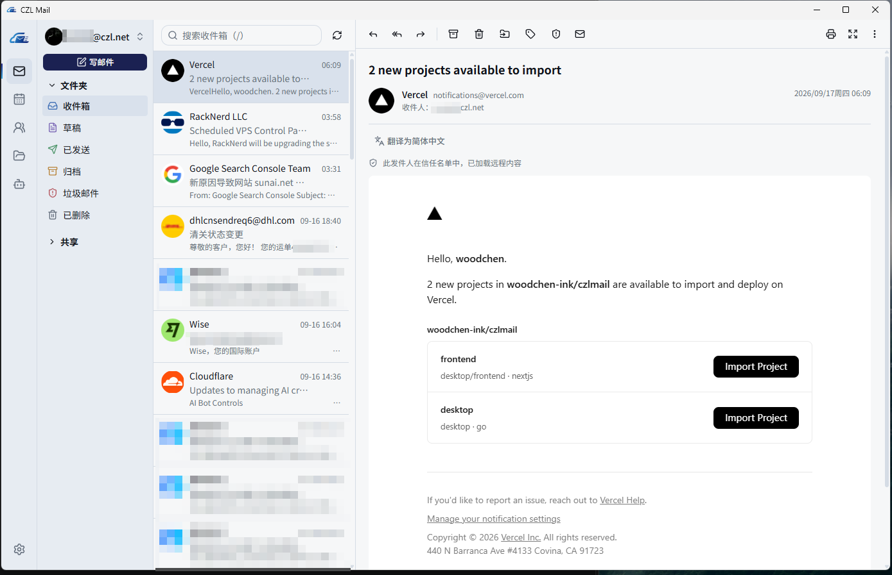
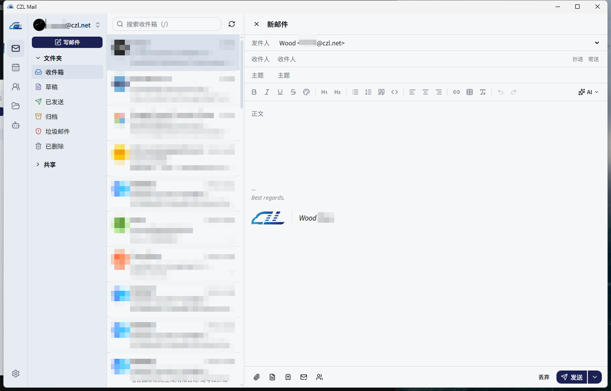
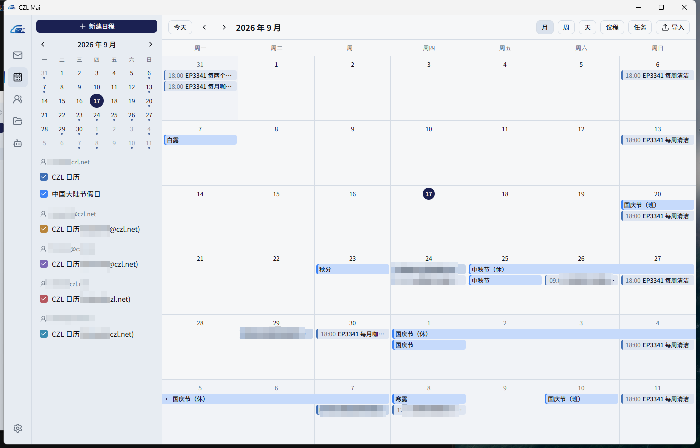
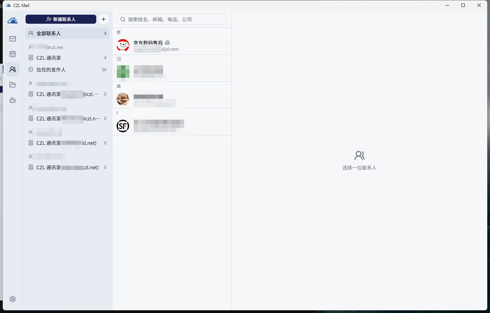
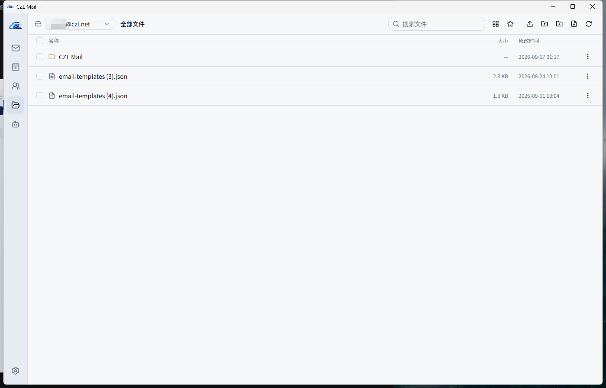
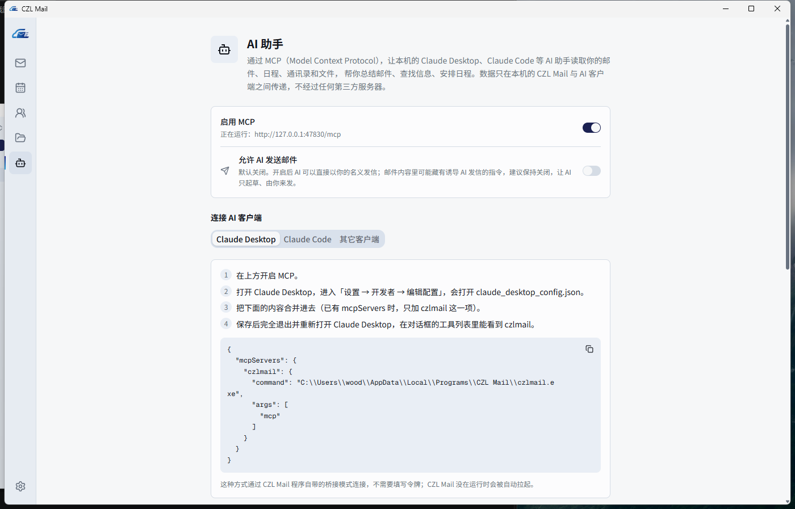
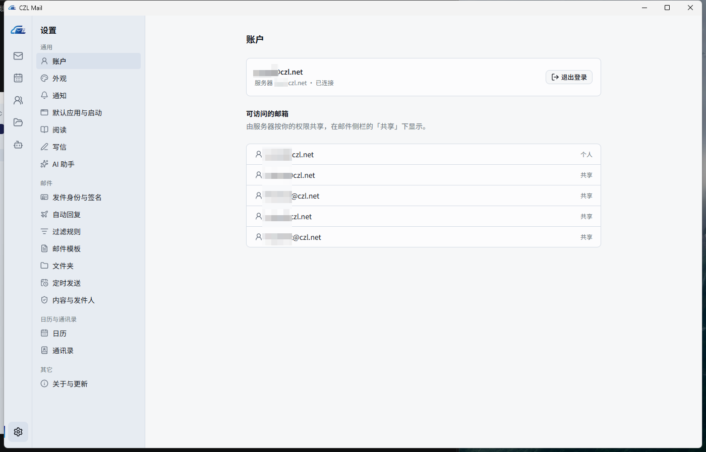
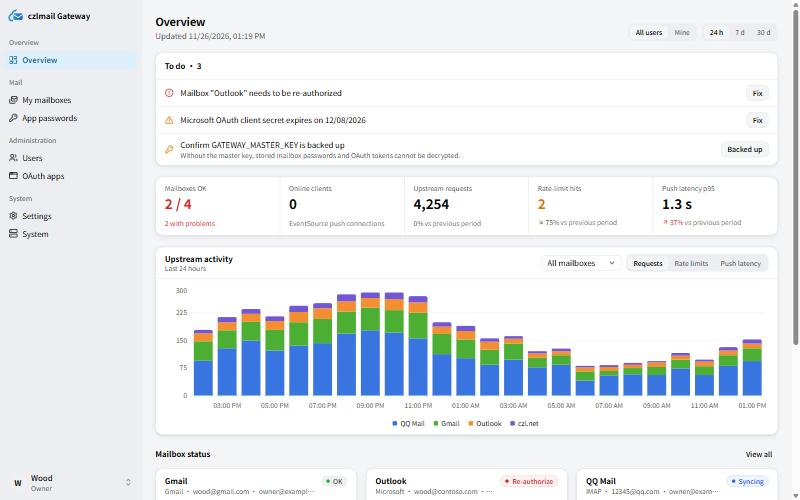

<p align="center"></p>

<h1 align="center">CZL Mail</h1>

<p align="center">
A native <a href="https://jmap.io">JMAP</a> client for <a href="https://stalw.art">Stalwart</a> and other JMAP servers,
and through the self-hosted <a href="#czlmail-gateway">czlmail gateway</a> also for Gmail, Outlook / Microsoft 365 and any IMAP mailbox.<br>
Mail, calendar, contacts, files and notes on Windows, macOS, Android and iPhone, with a built-in <b>MCP server</b> and <b>AI assistant</b>.
</p>

<p align="center"><b>English</b> · <a href="README.zh-CN.md">简体中文</a></p>

---

<p align="center"></p>

## Platforms

| Platform | Get it | Notes |
|---|---|---|
| **Windows** | [`czlmail-amd64-installer.exe`](https://github.com/woodchen-ink/czlmail/releases/latest) | per-user install, no admin rights; signed auto-update |
| **macOS** | [`czlmail-darwin-universal.dmg`](https://github.com/woodchen-ink/czlmail/releases/latest) | Intel and Apple silicon, macOS 10.15+; notarized |
| **Android** | [`czlmail-android.apk`](https://github.com/woodchen-ink/czlmail/releases/latest/download/czlmail-android.apk) | Android 8.0+; updates inside the app |
| **iPhone** | [App Store](https://apps.apple.com/app/id6834485924) | iOS 16+, one-time purchase; not yet in mainland China |
| **Phone browser** | [mail-notes.czl.net](https://mail-notes.czl.net) | read your notes only; [deploy your own](web-phone-note/README.md) |

The desktop and phone apps are one code base with the same features; MCP and folder picking are desktop-only. Details in [Install](#install).

## Works with

- **Stalwart and other JMAP servers.** CZL Mail signs in with an app password, through the browser (OAuth), or through your
  own identity provider ([SSO](#single-sign-on-sso)). It reads what each server announces and only shows what that server
  supports: an account without calendars, files or Sieve simply has no such pages.
- **Gmail, Outlook / Microsoft 365 and IMAP mailboxes** through the [czlmail gateway](#czlmail-gateway), which you host
  yourself. Each mailbox becomes its own account in CZL Mail; the client stays pure JMAP.
- **Several servers at once.** Add more sign-ins under Settings → Accounts. Shared mailboxes and every sign-in's accounts can
  be read together in one unified view, and compose, notifications, reminders, MCP and iPhone push cover all of them.

## Why this exists

[Bulwark](https://github.com/bulwarkmail/webmail) is an excellent JMAP webmail for Stalwart, and it shaped
many decisions here. But a webmail lives in a browser tab. CZL Mail exists so that **a JMAP server + one native
app** is the whole setup:

- **Starts instantly.** A native Go binary with the system WebView: no browser, no server-side web app to deploy.
- **Opens mail instantly.** Everything is cached in a local SQLite database and kept current over a single
  JMAP push (EventSource) connection. Reading, searching and switching folders hit the disk, not the network.
- **System-level notifications.** New mail and calendar reminders arrive through the OS notification center,
  and keep arriving with the window closed (tray / menu bar) or at login (autostart). On Android they keep
  arriving with the app in the background; on iPhone they arrive as push notifications even when the app is closed.
  Tapping one opens that message.
- **Agents can use your mailbox.** A local MCP server lets Claude, Codex and other agents read, search,
  organize and send mail, manage your calendar, tasks and notes, and look up contacts, with your consent and a local token.
- **AI where you need it.** Plug in any OpenAI-compatible Responses API: translate or summarize a message,
  polish or translate a draft, or describe what you want to say and let it draft the reply.

## Features

**Mail**: multiple accounts, shared mailboxes and a unified view of all accounts · conversations with a timeline ·
rich-text compose with HTML signatures, templates, read receipts, "send separately" and scheduled send · drafts auto-save ·
S/MIME signing and verification · folder create / rename / move / delete, drag messages onto a folder ·
full-text search (CJK-aware), also across every folder on the server · remote content blocked by default with a
trusted-senders list shared with Bulwark · verification codes and attachment names shown in the list ·
batch actions, context menus, undo (Ctrl+Z) and customizable keyboard shortcuts · one-click unsubscribe (RFC 8058) ·
calendar invitations answered right in the message · attachments open locally with one click · pull an entire folder from the server

**Calendar**: month / week / day / agenda views with multi-day events drawn as connected bars ·
side-panel editor with meeting links, attendees and invitations, RSVP, multiple reminders and recurrence ·
tasks · calendar management · `.ics` / `webcal:` import · reminders from the system, also on the phone

**Contacts**: full JSContact editor (photo, name components, organization, addresses, online services,
anniversaries, categories) · groups · address books · vCard import · every message exchanged with a contact, filtered by sent and received

**Files**: JMAP file storage (Stalwart) with list / grid views, favorites, cut / copy / paste, drag-and-drop upload

**Notes**: plain Markdown files kept in your file storage, editable offline and synced across devices, with daily notes
marked on the calendar and attachment previews · read them on your phone with the [web reader](web-phone-note/README.md)
(hosted at https://mail-notes.czl.net, or deploy your own)

**AI and MCP**: translation (subject and body, in place, cached), summaries, polish and translate drafts, reply with intent ·
an MCP server with tools for mail, drafts, threads, labels, calendar, tasks, contacts, files and notes · AI and MCP settings
sync across your devices through your file storage

**Server-side settings**: identities and HTML signatures, vacation auto-reply, Sieve filters
(rule builder compatible with Bulwark's rules, plus a raw Sieve editor)

**Desktop integration**: tray / menu bar with unread count, autostart, default `mailto:` / `.ics` / `webcal:` handler,
remembered window layout, signed auto-update from GitHub Releases (SHA-256 verified)

**Phones**: the same app with a single-column layout: mail, calendar, contacts, files, notes, search, translation and
AI summaries · system back gesture on Android · credentials in the system keychain (Android Keystore on Android) · iPhone push content is
end-to-end encrypted with a key that stays on the phone. Source and build notes: [android/](android/README.md)

**Languages**: English, 简体中文, Čeština and Русский; follows the system language until you pick one

## Screenshots


| Compose with HTML signature | Calendar with multi-day events |
|---|---|
|  |  |

| Contacts | Files |
|---|---|
|  |  |

| MCP for AI agents | Settings |
|---|---|
|  |  |

## czlmail Gateway

CZL Mail speaks only JMAP. To use it with **Gmail, Outlook / Microsoft 365 or any IMAP mailbox**, run the
[czlmail gateway](gateway/README.md) on your own server: it connects those mailboxes and serves them to CZL Mail
as one JMAP server, so the client stays pure JMAP. Each mailbox you add in the gateway's admin shows up as its own
account, new mail is pushed (iPhone background notifications included), and every mailbox can use its own SOCKS5 proxy.
It ships as a Docker image; credentials stay on your server, encrypted.

<p align="center"></p>

Deployment and usage guide: [English](gateway/docs/guide.md) · [简体中文](gateway/docs/guide.zh-CN.md)

## MCP: let agents use your mailbox

Enable it in the app under **AI Assistant → MCP**. The page shows ready-to-paste configuration.
Keep CZL Mail running when using MCP (it can stay in the tray or menu bar). The stdio bridge never starts
the app or brings its window to the foreground; it fails immediately if the app is not running or MCP is disabled.

Tools: `list_accounts`, `list_mailboxes`, `list_emails`, `search_emails`, `read_email`, `mark_read`,
`send_email`, `list_events`, `create_event`, `search_contacts`, `list_files`.

Two transports are available:

```bash
# stdio (the app bridges to the running instance)
claude mcp add --scope user czlmail -- "C:\Users\<you>\AppData\Local\CZL\CZL Mail\czlmail.exe" mcp

# Streamable HTTP on 127.0.0.1 with a bearer token
claude mcp add --scope user --transport http czlmail http://127.0.0.1:47830/mcp --header "Authorization: Bearer <token>"
```

The server only listens on loopback, requires the token, and rejects browser (cross-origin) requests.
Message content is always handed to the model as data, not instructions.

## AI assistant

**Settings → AI Assistant**: base URL, API key (stored in the OS keychain) and model name. Any service that
implements the OpenAI **Responses API** (`/v1/responses`) works. AI buttons only appear after AI is configured
and enabled.

- **Translate** a message into your default language in place — only the text changes, the original layout and styles stay — with one click back to the original
- **Polish** or **translate** what you've written in the compose window
- **Reply with intent** — type "accept, but ask to ship before Wednesday" and get a draft reply

## Install

Download the latest release from [Releases](https://github.com/woodchen-ink/czlmail/releases):

- Windows: `czlmail-amd64-installer.exe` (per-user install, no admin rights needed)
- macOS: `czlmail-darwin-universal.dmg` (Intel and Apple silicon, macOS 10.15+)
- Android: [`czlmail-android.apk`](https://github.com/woodchen-ink/czlmail/releases/latest/download/czlmail-android.apk) (Android 8.0+, 64-bit ARM and x86_64), or scan the QR code with your phone.
  Allow the install when prompted; later updates are offered inside the app
  (**Settings → About & updates**), and the first one asks you to allow CZL Mail to install apps.

  
- iPhone: [App Store](https://apps.apple.com/app/id6834485924) (iOS 16+, paid one-time purchase, not yet available in mainland China).
- Phone (read notes only): open **https://mail-notes.czl.net** and sign in with your server, email and an app password;
  add it to the home screen to use it like an app. It is only static files: your browser talks to your own mail server directly,
  and we never receive or store your password or notes.
  It needs a JMAP server with file storage and CORS ([details](web-phone-note/README.md#server-requirements)).

What changed in each version: [release notes](https://github.com/woodchen-ink/czlmail/releases).

### Opening on macOS for the first time

The app is signed with a Developer ID and notarized by Apple. Open the DMG, drag **CZL Mail** into Applications
and open it from there. Move it to Applications before the first launch: when run straight from the DMG or Downloads,
macOS runs it from a random temporary path and autostart cannot remember where it is.

Closing the window keeps the app in the menu bar (with the unread count next to the icon); click the Dock icon
or **Open CZL Mail** in the menu bar to bring the window back, and ⌘Q to quit.

### Signing in

- **A JMAP server** (such as Stalwart): its address, your email and an **app password** generated on that server,
  or browser sign-in (OAuth / [SSO](#single-sign-on-sso)) if the server offers it.
- **Gmail, Outlook or IMAP through the [czlmail gateway](#czlmail-gateway)**: the gateway's address, your gateway email
  and an **app password** generated in the gateway's admin.

## Single sign-on (SSO)

Stalwart can delegate authentication to an external identity provider (an OIDC directory such as Authentik,
Keycloak or your own OIDC service). In that setup Stalwart's own authorization page only accepts local
passwords and never redirects to the identity provider, so the client **authorizes directly with the identity
provider** and uses that token against the mail server — the same approach Bulwark takes.

**An administrator needs to do two things:**

1. **Create a public client on the identity provider**: no client secret (token endpoint auth method `none`),
   PKCE enabled, with these redirect URIs:

   ```
   http://127.0.0.1:47821/callback
   http://127.0.0.1:47822/callback
   http://127.0.0.1:47823/callback
   http://127.0.0.1:47824/callback
   ```

   Request the `openid email profile` scopes; Stalwart maps the `email` claim to the account.

2. **Publish the sign-in auto-configuration** at `/.well-known/czlmail.json` on the mail server's host or a parent
   domain (for `mail.example.com`, either `https://mail.example.com/` or `https://example.com/`; HTTPS redirects are followed):

   ```json
   {
     "version": 1,
     "oauth": {
       "name": "Example SSO",
       "issuer": "https://sso.example.com",
       "clientId": "<public client id>"
     }
   }
   ```

Users then just enter the server address; the client reads this file and shows **"Sign in with Example SSO"**.
Without the file, the identity provider address and client ID can be entered manually under
"browser sign-in → single sign-on".

The file is only fetched over HTTPS, so its origin is guaranteed by the domain's certificate. The client ID is not a secret.

## Build from source

Requires Go 1.26+, Node 22+, pnpm and the [Wails v2 CLI](https://wails.io/docs/gettingstarted/installation) (v2.17).

```bash
cd desktop
wails dev      # development with hot reload
wails build    # build/bin/czlmail(.exe)
go test ./...  # unit tests
```

On Windows, `build.bat v0.1.0` builds the executable and the NSIS installer.
The Android app also needs JDK 21 and the Android SDK + NDK; see [android/README.md](android/README.md).

Integration tests run against a live server and are skipped unless credentials come from the environment
(`CZLMAIL_TEST_SESSION`, `CZLMAIL_TEST_USER`, `CZLMAIL_TEST_PASS`).

## Uninstall and delete data

- **Settings → Account → Delete all data** removes the local mail cache, settings, logs, downloaded attachments,
  and the credentials and AI key in the OS keychain, removes autostart and default-app registrations, then quits.
  Mail, calendars and contacts on the server are not affected.
- **When uninstalling**, tick "also delete all data" for the same effect. It is unticked by default, so a reinstall
  keeps you signed in with your cache intact.

## Security

- Mail bodies are sanitized (DOMPurify), rendered in a sandboxed iframe without same-origin, under a strict CSP.
- Remote images are blocked unless the sender is trusted; trust is per address, never per domain.
- Credentials and API keys live only in the OS keychain (on Android, encrypted with a non-exportable Android Keystore key);
  there is no plaintext fallback.
- Updates are only installed when the download matches the release's `SHA256SUMS`.

## Feedback

Questions, bugs and ideas: open an [issue](https://github.com/woodchen-ink/czlmail/issues) or leave a
comment in the [forum thread](https://sunai.net/t/topic/1485). Release notes for every version are
on the [releases page](https://github.com/woodchen-ink/czlmail/releases).

## License

[AGPL-3.0](LICENSE), the same license as Bulwark.

## Acknowledgements

- [Stalwart](https://stalw.art) — the JMAP mail server this client was first built for
- [Bulwark](https://github.com/bulwarkmail/webmail) — whose feature set and filter format this client follows
- [go-jmap](https://git.sr.ht/~rockorager/go-jmap), [Wails](https://wails.io), [TipTap](https://tiptap.dev), [shadcn/ui](https://ui.shadcn.com)
