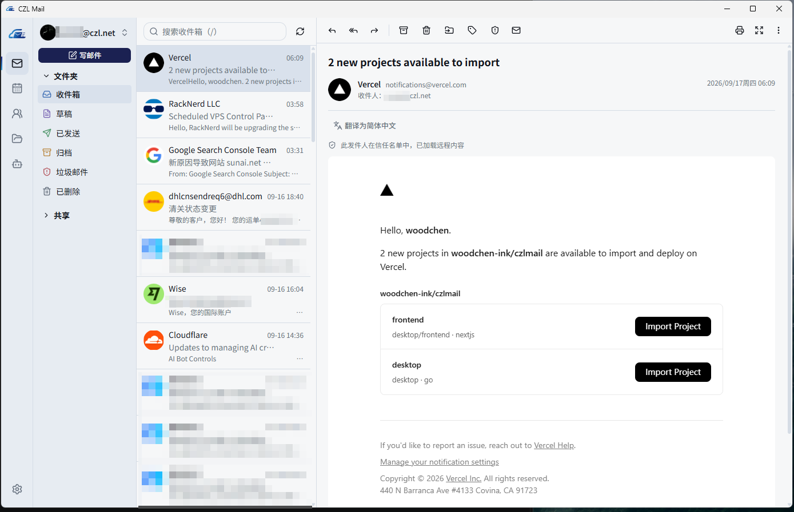
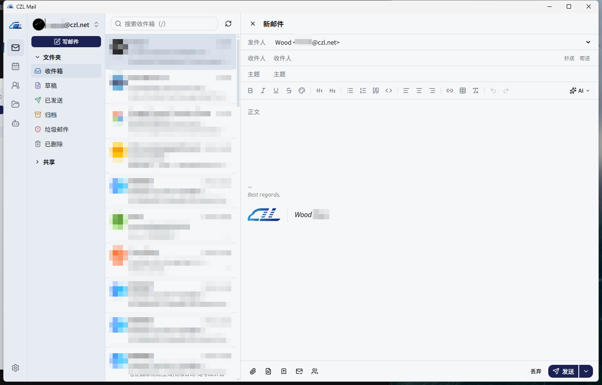
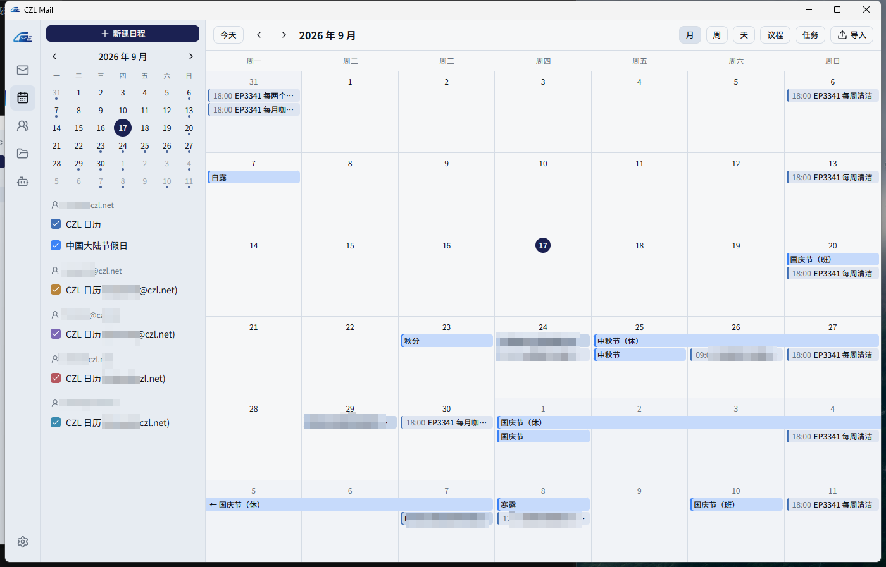
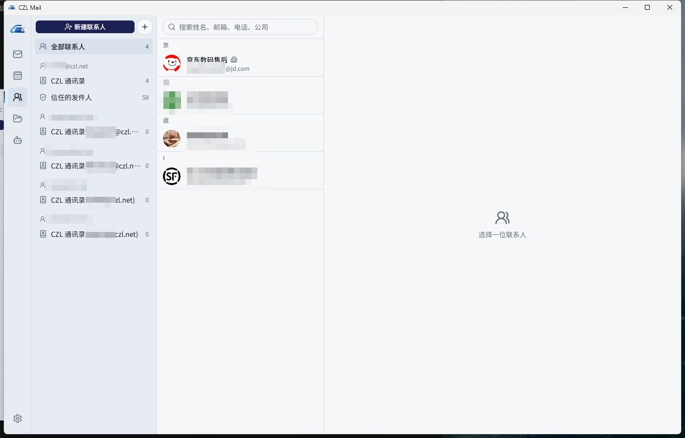
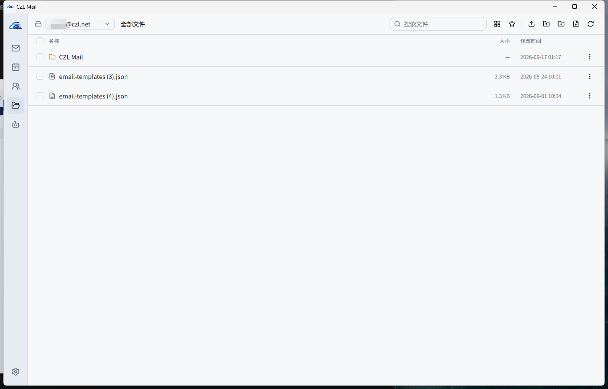
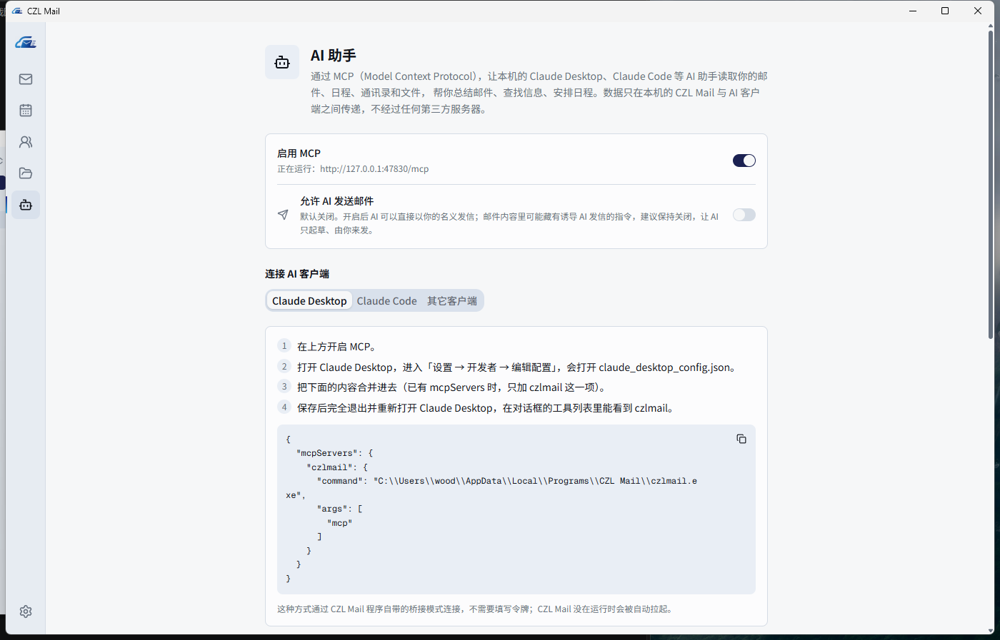
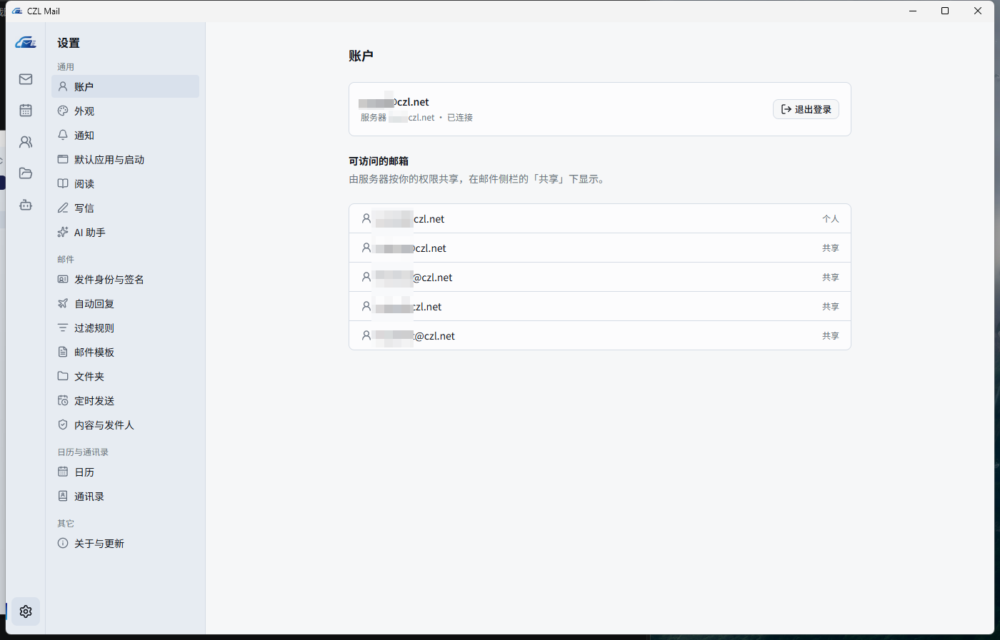
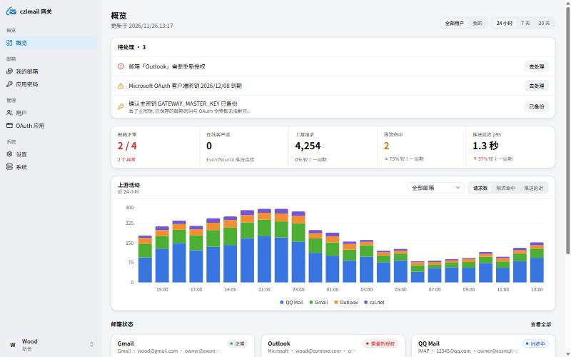

<p align="center"></p>

<h1 align="center">CZL Mail</h1>

<p align="center">
<a href="https://jmap.io">JMAP</a> 原生客户端，直接连接 <a href="https://stalw.art">Stalwart</a> 等 JMAP 服务器；
配上自部署的 <a href="#czlmail-网关">czlmail 网关</a>，Gmail、Outlook / Microsoft 365 和任意 IMAP 邮箱也能用。<br>
邮件、日历、通讯录、网盘、笔记，覆盖 Windows、macOS、Android 与 iPhone，内置 <b>MCP 服务</b> 与 <b>AI 助手</b>。
</p>

<p align="center"><a href="README.md">English</a> · <b>简体中文</b></p>

---

<p align="center"></p>

## 平台

| 平台 | 获取 | 说明 |
|---|---|---|
| **Windows** | [`czlmail-amd64-installer.exe`](https://github.com/woodchen-ink/czlmail/releases/latest) | 按用户安装，不需要管理员权限；自动更新 |
| **macOS** | [`czlmail-darwin-universal.dmg`](https://github.com/woodchen-ink/czlmail/releases/latest) | Intel 与 Apple 芯片通用，macOS 10.15+；已经 Apple 公证 |
| **Android** | [`czlmail-android.apk`](https://github.com/woodchen-ink/czlmail/releases/latest/download/czlmail-android.apk) | Android 8.0+；在应用内更新 |
| **iPhone** | [App Store](https://apps.apple.com/app/id6834485924) | iOS 16+，买断制；中国大陆暂未上架 |
| **手机浏览器** | [mail-notes.czl.net](https://mail-notes.czl.net) | 只读查看笔记；[可自行部署](web-phone-note/README.zh-CN.md) |

桌面端与手机端是同一套代码、同样的功能，只有 MCP 和选择文件夹限桌面端。安装细节见[安装](#安装)。

## 能连哪些邮箱

- **Stalwart 与其他 JMAP 服务器。** 可以用应用专用密码、浏览器授权（OAuth）或你自己的身份提供商（[单点登录](#单点登录sso)）登录。
  客户端按每台服务器公布的能力显示功能，服务器没有日历、网盘或 Sieve，对应页面就不出现。
- **Gmail、Outlook / Microsoft 365 与 IMAP 邮箱**，通过自部署的 [czlmail 网关](#czlmail-网关)。每个邮箱在 CZL Mail 里是一个独立账号，客户端仍然只说 JMAP。
- **同时登录多台服务器。** 在「设置 → 账户」里添加更多登录。共享邮箱和所有登录下的账号可以放进同一个统一视图里看；
  写信、通知、提醒、MCP 和 iPhone 推送都覆盖全部登录。

## 为什么要写这个项目

[Bulwark](https://github.com/bulwarkmail/webmail) 是 Stalwart 上很好的 JMAP 网页邮箱，本项目的很多设计都参考了它。
但网页邮箱始终活在浏览器标签页里。CZL Mail 的目标是：**一台 JMAP 服务器加一个原生客户端**就够了，不用再单独部署网页邮箱。

- **原生启动，秒开。** Go 原生程序加系统自带的 WebView，不依赖浏览器，也不用在服务器上部署网页应用。
- **邮件缓存，打开即看。** 所有邮件缓存在本地 SQLite，通过一条 JMAP 推送（EventSource）连接实时保持同步；
  阅读、搜索、切换文件夹读的是本地磁盘，而不是等网络。
- **系统级通知。** 新邮件和日程提醒走操作系统通知中心；关掉窗口驻留托盘（macOS 为菜单栏）、开机自启后都能及时收到。
  Android 退到后台照常收信，iPhone 关掉 App 也能收到推送，点通知直接打开那封邮件。
- **让 Agent 使用你的邮箱。** 内置本地 MCP 服务，Claude、Codex 等 Agent 可以读取、搜索、整理和发送邮件，管理日程、任务和笔记，查找联系人；
  需要你在软件里开启，并使用本地令牌。
- **AI 就在手边。** 接入任意兼容 OpenAI Responses API 的模型：翻译或总结邮件、润色或翻译草稿，
  说出回复意图让 AI 帮你起草。

## 功能

**邮件** —— 多账号、共享邮箱、所有账号的统一视图 · 会话按时间线展开 · 富文本写信（HTML 签名、模板、已读回执、分开发送、定时发送）·
草稿自动保存 · S/MIME 签名与验签 · 文件夹新建 / 重命名 / 移动 / 删除，邮件可拖到文件夹 · 全文搜索（支持中文），也能搜服务器上的全部文件夹 ·
默认拦截远程内容，信任发件人名单与 Bulwark 共用 · 列表直接显示验证码和附件名 · 批量操作、右键菜单、撤销（Ctrl+Z）、自定义快捷键 ·
一键退订（RFC 8058）· 在邮件里直接回复日历邀请 · 附件一键本地打开 · 右键从服务器拉取整个文件夹

**日历** —— 月 / 周 / 天 / 议程视图，跨天日程连成横条显示 · 右侧编辑面板（会议链接、参加者与邀请、回复邀请、
多个提醒、重复规则）· 任务 · 日历管理 · 导入 `.ics` / `webcal:` · 系统提醒，手机上同样准时

**通讯录** —— 完整的 JSContact 编辑（照片、姓名分量、工作单位、地址、在线服务、纪念日、类别）· 群组 · 通讯录管理 · 导入 vCard ·
查看和某个联系人的全部往来邮件，可按收发筛选

**网盘** —— JMAP 文件存储（Stalwart），列表 / 网格视图、收藏、剪切 / 复制 / 粘贴、拖入窗口上传

**笔记** —— 普通 Markdown 文件存在你的网盘里，可离线编辑、多设备同步；日记会标在日历上，附件可预览 ·
手机上用[网页阅读器](web-phone-note/README.zh-CN.md)查看（公开实例 https://mail-notes.czl.net，也可自己部署）

**AI 与 MCP** —— 翻译（主题和正文原地替换，结果缓存）、总结、润色与翻译草稿、按意图回复 ·
MCP 服务提供邮件、草稿、会话、标签、日历、任务、通讯录、网盘和笔记的工具 · AI 与 MCP 设置经网盘在设备间同步

**服务端设置** —— 发件身份与 HTML 签名、假期自动回复、Sieve 过滤规则（规则编辑器与 Bulwark 互通，另有原始 Sieve 编辑器）

**桌面集成** —— 托盘 / 菜单栏显示未读数、开机自启、设为默认的 `mailto:` / `.ics` / `webcal:` 应用、记住窗口布局、
基于 GitHub Releases 的自动更新（SHA-256 校验）

**手机** —— 同一套程序，按手机单栏排布：邮件、日历、通讯录、网盘、笔记、搜索、翻译与 AI 总结 · Android 支持系统返回手势 ·
凭据存在系统钥匙串（Android 上用 Android Keystore）· iPhone 推送内容用只存在手机上的密钥端到端加密。源码与构建说明见 [android/](android/README.md)

**界面语言** —— 简体中文、English、Čeština、Русский；没选过时跟随系统语言

## 截图


| 写信（HTML 签名） | 日历（跨天日程连成横条） |
|---|---|
|  |  |

| 通讯录 | 网盘 |
|---|---|
|  |  |

| MCP：接入 AI Agent | 设置 |
|---|---|
|  |  |

## czlmail 网关

CZL Mail 只说 JMAP。想用它收发 **Gmail、Outlook / Microsoft 365 或任何 IMAP 邮箱**，可以在自己的服务器上部署
[czlmail 网关](gateway/README.md)：网关连接这些邮箱，再作为一个 JMAP 服务器提供给 CZL Mail，客户端保持纯 JMAP。
在网关后台添加的每个邮箱在 CZL Mail 里都是一个独立账号，新邮件即时推送（包括 iPhone 后台通知），每个邮箱还可以单独走 SOCKS5 代理。
网关以 Docker 镜像发布，邮箱凭据加密保存在你自己的服务器上。

<p align="center"></p>

部署与使用教程：[简体中文](gateway/docs/guide.zh-CN.md) · [English](gateway/docs/guide.md)

## MCP：让 Agent 使用你的邮箱

在软件的 **AI 助手 → MCP** 页面开启，页面上有可以直接复制的配置。
调用 MCP 时需要让 CZL Mail 保持运行（可以收起到托盘或菜单栏）。stdio 桥不会自动启动程序或唤出窗口；程序未运行或 MCP 未启用时会直接报错。

工具：`list_accounts`、`list_mailboxes`、`list_emails`、`search_emails`、`read_email`、`mark_read`、
`send_email`、`list_events`、`create_event`、`search_contacts`、`list_files`。

两种接入方式：

```bash
# stdio（由程序转接到正在运行的实例）
claude mcp add --scope user czlmail -- "C:\Users\<你>\AppData\Local\CZL\CZL Mail\czlmail.exe" mcp

# Streamable HTTP，监听 127.0.0.1，需要 Bearer 令牌
claude mcp add --scope user --transport http czlmail http://127.0.0.1:47830/mcp --header "Authorization: Bearer <令牌>"
```

服务只监听本机回环地址，必须带令牌，并拒绝来自浏览器的跨源请求。邮件内容始终作为数据交给模型，而不是指令。

## AI 助手

在 **设置 → AI 助手** 填写接口地址、API Key（保存在系统钥匙串）和模型名称。任何实现了 OpenAI **Responses API**
（`/v1/responses`）的服务都可以使用。只有配置并启用后，界面上才会出现 AI 按钮。

- **翻译邮件**：一键把邮件翻译成默认语言，只替换文字，排版与样式保持原样，可随时切回原文
- **润色 / 翻译草稿**：写信时对正文一键优化或翻译
- **按意图回复**：输入「同意报价，但希望周三前发货」，AI 起草完整回复

## 安装

从 [Releases](https://github.com/woodchen-ink/czlmail/releases) 下载最新版本：

- Windows：`czlmail-amd64-installer.exe`（按用户安装，无需管理员权限）
- macOS：`czlmail-darwin-universal.dmg`（Intel 与 Apple 芯片通用，macOS 10.15+）
- Android：[`czlmail-android.apk`](https://github.com/woodchen-ink/czlmail/releases/latest/download/czlmail-android.apk)（Android 8.0+，64 位 ARM 与 x86_64），也可以用手机扫码下载。
  安装时按提示允许；之后的新版本在程序里（**设置 → 关于与更新**）更新，第一次更新需要允许 CZL Mail 安装应用。

  
- iPhone：[App Store](https://apps.apple.com/app/id6834485924)（iOS 16+，买断制付费，中国大陆暂未上架）。
- 手机（只读看笔记）：打开 **https://mail-notes.czl.net**，填服务器、邮箱和应用专用密码登录；
  添加到主屏幕后可以像 App 一样用。它只是一组静态文件，浏览器直接连你自己的邮件服务器，
  我们收不到、也不保存你的密码和笔记。
  需要服务器支持 JMAP 文件存储并允许跨域（[详情](web-phone-note/README.zh-CN.md#服务器要求)）。

每个版本改了什么，见 GitHub 的[发版日志](https://github.com/woodchen-ink/czlmail/releases)。

### macOS 首次打开

程序使用 Developer ID 签名并经过 Apple 公证。打开 DMG，把 **CZL Mail** 拖进「应用程序」，再从「应用程序」里打开即可。
请先拖进「应用程序」再运行：直接在 DMG 或下载文件夹里运行时，系统会把程序放到临时的随机路径，开机自启无法记住它的位置。

关闭窗口后程序驻留在菜单栏（图标旁显示未读数），点 Dock 图标或菜单栏「打开 CZL Mail」恢复窗口，⌘Q 退出。

### 登录

- **JMAP 服务器**（如 Stalwart）：填服务器地址、邮箱和在这台服务器上生成的**应用专用密码**；服务器支持时也可以用浏览器授权（OAuth / [单点登录](#单点登录sso)）。
- **通过 [czlmail 网关](#czlmail-网关)接入 Gmail、Outlook 或 IMAP**：填网关地址、登录网关用的邮箱，以及网关后台生成的**应用专用密码**。

## 单点登录（SSO）

Stalwart 可以把用户认证交给外部身份提供商（OIDC 目录，例如 Authentik、Keycloak、自建的 OIDC 服务）。
这种部署下 Stalwart 自带的授权页只认本地密码，不会跳转到身份提供商，所以客户端需要**直接向身份提供商授权**，
再用拿到的令牌访问邮件服务器 —— 与 Bulwark 的做法相同。

**管理员需要做两件事：**

1. **在身份提供商上创建公开客户端**：无客户端密钥（token endpoint auth method 为 `none`）、启用 PKCE，
   回调地址填写：

   ```
   http://127.0.0.1:47821/callback
   http://127.0.0.1:47822/callback
   http://127.0.0.1:47823/callback
   http://127.0.0.1:47824/callback
   ```

   权限范围需要 `openid email profile`；Stalwart 通过 `email` 声明找到对应账号。

2. **发布登录自动配置**：在邮件服务器域名或其上级域名的网站上放置 `/.well-known/czlmail.json`
   （例如服务器是 `mail.example.com`，放在 `https://mail.example.com/` 或 `https://example.com/` 下均可，支持 HTTPS 跳转）：

   ```json
   {
     "version": 1,
     "oauth": {
       "name": "Example SSO",
       "issuer": "https://sso.example.com",
       "clientId": "公开客户端 ID"
     }
   }
   ```

完成后，用户在登录页填写服务器地址，客户端会自动读取这个文件并显示 **「使用 Example SSO 登录」**，
点击后在浏览器中用单点登录账号登录即可，无需填写任何其它信息。
没有发布配置文件时，也可以在「浏览器授权登录 → 通过单点登录」里手动填写身份提供商地址和客户端 ID。

配置文件只从 HTTPS 读取，由域名证书保证来源；客户端 ID 不是秘密，可以公开。

## 从源码构建

需要 Go 1.26+、Node 22+、pnpm 与 [Wails v2 CLI](https://wails.io/docs/gettingstarted/installation)（v2.17）。

```bash
cd desktop
wails dev      # 开发模式，热重载
wails build    # 产物在 build/bin/
go test ./...  # 单元测试
```

Windows 上可以用 `build.bat v0.1.0` 一次生成程序与 NSIS 安装包。
Android 版另外需要 JDK 21 与 Android SDK + NDK，见 [android/README.md](android/README.md)。

集成测试连接真实服务器，凭据只从环境变量读取（`CZLMAIL_TEST_SESSION`、`CZLMAIL_TEST_USER`、`CZLMAIL_TEST_PASS`），未提供时自动跳过。

## 卸载与删除数据

- **设置 → 账户 → 删除所有数据**：删除本机的邮件缓存、设置、日志、已下载的附件，以及系统钥匙串里的登录凭据与 AI 密钥，
  取消开机自启与默认应用登记，然后退出。服务器上的邮件、日历、联系人不受影响。
- **卸载时**可以勾选「同时删除所有数据」，效果相同；默认不勾选，重新安装后无需重新登录与同步。

## 安全

- 邮件正文经 DOMPurify 清洗，在不同源的沙箱 iframe 中渲染，并有严格的 CSP。
- 远程图片默认拦截，只对信任的发件人放行；信任按完整地址，从不按域名。
- 凭据与 API Key 只保存在系统钥匙串（Android 上用不可导出的 Android Keystore 密钥加密），没有明文回落。
- 在线更新只安装与发布版 `SHA256SUMS` 一致的安装包。

## 反馈

使用中遇到问题或有建议，欢迎提 [Issue](https://github.com/woodchen-ink/czlmail/issues)，或到[论坛反馈帖](https://sunai.net/t/topic/1485)留言。历次版本说明见 GitHub 的[发版日志](https://github.com/woodchen-ink/czlmail/releases)。

## 许可证

[AGPL-3.0](LICENSE)，与 Bulwark 相同。

## 致谢

- [Stalwart](https://stalw.art) —— 本客户端最初为它打造的 JMAP 邮件服务器
- [Bulwark](https://github.com/bulwarkmail/webmail) —— 功能设计与过滤规则格式的参考
- [go-jmap](https://git.sr.ht/~rockorager/go-jmap)、[Wails](https://wails.io)、[TipTap](https://tiptap.dev)、[shadcn/ui](https://ui.shadcn.com)
