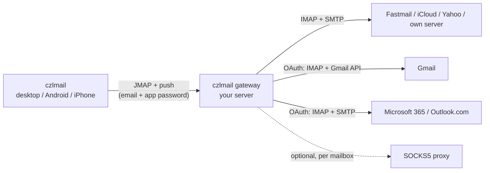
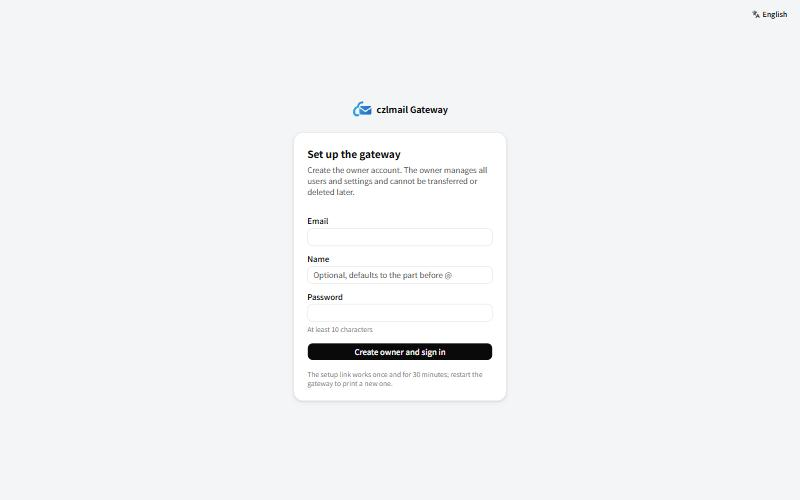
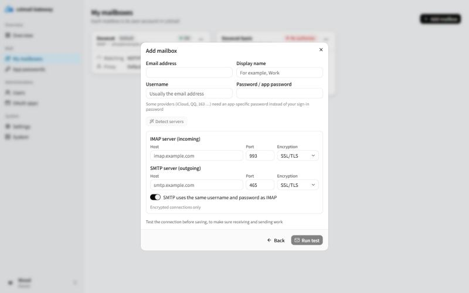
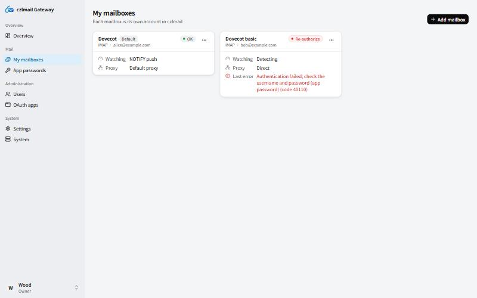
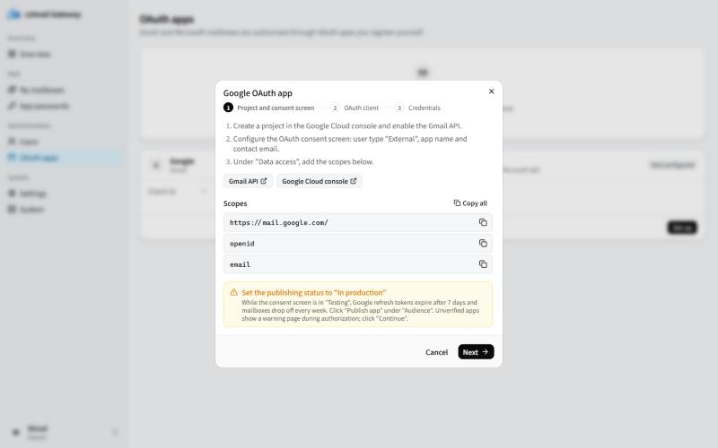
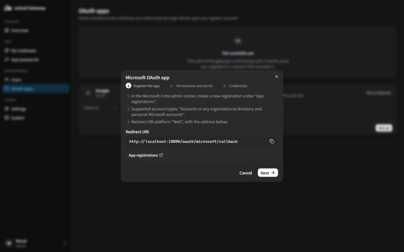
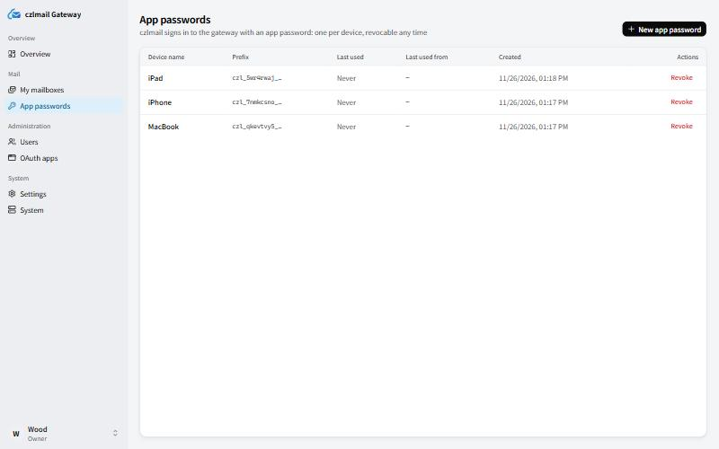
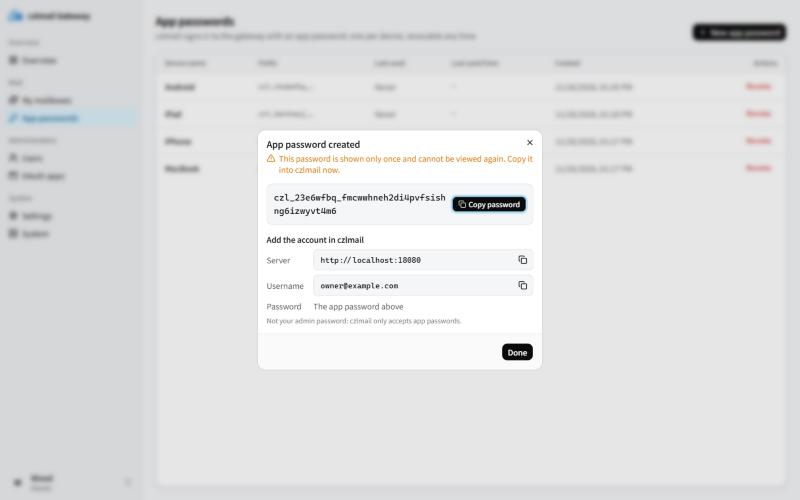
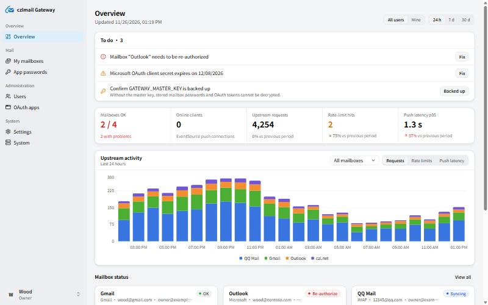
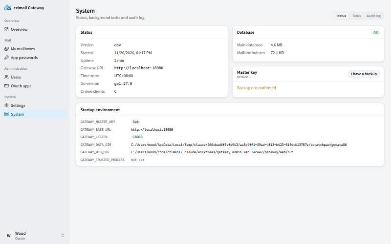

# czlmail gateway: deployment and usage guide

**English** · [简体中文](guide.zh-CN.md)

## Contents

1. [What the gateway is](#1-what-the-gateway-is)
2. [Deploy](#2-deploy)
3. [First run](#3-first-run)
4. [Add an IMAP mailbox](#4-add-an-imap-mailbox)
5. [Add Gmail](#5-add-gmail)
6. [Add Microsoft 365 / Outlook.com](#6-add-microsoft-365--outlookcom)
7. [Sending settings](#7-sending-settings)
8. [Sign in from czlmail](#8-sign-in-from-czlmail)
9. [Overview and mailbox status](#9-overview-and-mailbox-status)
10. [Upgrades and backups](#10-upgrades-and-backups)
11. [FAQ](#11-faq)

## 1. What the gateway is

czlmail speaks only JMAP, so on its own it connects to JMAP servers such as Stalwart. The czlmail gateway is a translation service you host yourself: it signs in to your Gmail, Microsoft 365 / Outlook.com and any IMAP + SMTP mailbox (Fastmail, iCloud, Yahoo, your own mail server and so on), and serves them to czlmail as a JMAP server. czlmail needs no protocol adapters; it signs in to the gateway and sends and receives mail for all of those mailboxes.

It is for people whose mail is not on Stalwart and who want to use czlmail, especially with several mailboxes, or with mailboxes that can only be reached through a proxy.



- Every mailbox you add in the gateway admin is a separate account in czlmail; czlmail signs in to the gateway with one email and app password.
- The gateway watches the upstreams with IMAP NOTIFY / IDLE, polls where it has to, and pushes changes to czlmail over EventSource. iPhones get new-mail notifications in the background too. czlmail itself never polls.
- Each mailbox connects directly, through the gateway's default SOCKS5 proxy, or through its own proxy.
- The mail index and credentials live in SQLite on your server; mailbox passwords and OAuth tokens are encrypted with the master key.
- The admin is at `/admin`, in English and Chinese.

## 2. Deploy

### 2.1 Before you start

- A server with Docker that can reach your mail providers
- A domain pointing at it; this guide uses `mail-gw.example.com`
- A TLS reverse proxy (Caddy, nginx, Traefik…); the gateway itself listens on plain HTTP port 8080

The image is `ghcr.io/woodchen-ink/czlmail-gateway`, for amd64 and arm64:

| Tag | Meaning |
| --- | --- |
| `latest` | the newest release |
| `YYYY.M` | the newest release of that month, e.g. `2026.11` |
| `YYYY.M.N` | one fixed release, e.g. `2026.11.0` |
| `edge` | the latest build of `main`, not released |

### 2.2 Generate and back up the master key

`GATEWAY_MASTER_KEY` is 32 random bytes in base64. It encrypts mailbox passwords, OAuth tokens and proxy passwords in the database:

```sh
openssl rand -base64 32
```

Put it in your password manager right away. The key and the data volume only work together: without the key, every stored credential is lost and each mailbox has to be added again. The gateway refuses to start with a key that does not match its data.

### 2.3 Deploy with docker compose

Create a directory with two files.

`.env`:

```ini
GATEWAY_MASTER_KEY=<the master key>
GATEWAY_BASE_URL=https://mail-gw.example.com
TZ=Europe/Berlin
```

`docker-compose.yml`:

```yaml
services:
  gateway:
    image: ghcr.io/woodchen-ink/czlmail-gateway:latest
    restart: unless-stopped
    ports:
      - "127.0.0.1:8080:8080"   # only for the reverse proxy on this host
    environment:
      GATEWAY_MASTER_KEY: ${GATEWAY_MASTER_KEY:?}
      GATEWAY_BASE_URL: ${GATEWAY_BASE_URL:?}
      GATEWAY_TRUSTED_PROXIES: ${GATEWAY_TRUSTED_PROXIES:-}
      TZ: ${TZ:-UTC}
    volumes:
      - gateway-data:/data

volumes:
  gateway-data:
```

Start it:

```sh
docker compose up -d
docker compose logs -f gateway
```

### 2.4 Deploy with docker run

```sh
docker run -d --name czlmail-gateway --restart unless-stopped \
  -p 127.0.0.1:8080:8080 \
  -e GATEWAY_MASTER_KEY='<master key>' \
  -e GATEWAY_BASE_URL=https://mail-gw.example.com \
  -e TZ=Europe/Berlin \
  -v czlmail-gateway-data:/data \
  ghcr.io/woodchen-ink/czlmail-gateway:latest
```

### 2.5 Environment variables

Only startup settings are environment variables. Everything else (sign-up, default proxy, OAuth apps…) is set in the admin and applies at once.

| Variable | Purpose | Default |
| --- | --- | --- |
| `GATEWAY_MASTER_KEY` | The master key, see [2.2](#22-generate-and-back-up-the-master-key) | required |
| `GATEWAY_BASE_URL` | The gateway's public address, e.g. `https://mail-gw.example.com`. JMAP session URLs and OAuth redirect URIs are built from it, so it must match what browsers and czlmail actually use (scheme, host, port). `https` only; `http://localhost` for local tests | required |
| `GATEWAY_TRUSTED_PROXIES` | Trusted reverse proxies as `Header@cidr,cidr`, e.g. `X-Real-IP@172.16.0.0/12`. The gateway then takes the client IP from that header (for sign-in rate limits and "last used from"); empty uses the direct peer address | empty |
| `TZ` | Time zone for logs and the admin | `UTC` |
| `GATEWAY_LISTEN` | Listen address | `:8080` |
| `GATEWAY_DATA_DIR` | Data directory | `/data` |

### 2.6 Reverse proxy

`/jmap/eventsource` is a long-lived stream: the proxy must not buffer it or cut it early. czlmail asks for a heartbeat every 30 seconds, so any read timeout well above 30 seconds works. Attachments go up to 50 MB, so raise the body size limit.

**Caddy** (gets certificates by itself and never buffers EventSource):

```caddy
mail-gw.example.com {
    reverse_proxy 127.0.0.1:8080 {
        header_up X-Real-IP {remote_host}
    }
}
```

Pair it with `GATEWAY_TRUSTED_PROXIES=X-Real-IP@127.0.0.1/32` when Caddy runs on the same host and the gateway port is published on localhost. If Caddy runs in Docker too, use the Docker network's range instead, e.g. `172.16.0.0/12`.

**nginx**:

```nginx
server {
    listen 443 ssl http2;
    server_name mail-gw.example.com;
    # ssl_certificate / ssl_certificate_key ...

    client_max_body_size 60m;

    location / {
        proxy_pass http://127.0.0.1:8080;
        proxy_http_version 1.1;
        proxy_set_header Host $host;
        proxy_set_header X-Real-IP $remote_addr;
        proxy_set_header X-Forwarded-Proto $scheme;
        proxy_buffering off;          # the gateway also sends X-Accel-Buffering: no
        proxy_read_timeout 1h;
    }
}
```

### 2.7 Behind the Cloudflare proxy

The gateway works with Cloudflare's proxy (orange cloud) on. Mind these points:

- Idle timeout of 100 seconds: Cloudflare closes connections that carry no data for 100 seconds. czlmail opens EventSource with `ping=30`, so the gateway sends a heartbeat every 30 seconds and the stream stays up. Other JMAP clients must also ask for a `ping` below 100 seconds, or the stream drops every 100 seconds and push resumes only after they reconnect.
- SSL mode Full (strict), with a valid certificate on the origin (Caddy's is fine).
- Real client IPs: behind Cloudflare the reverse proxy sees Cloudflare's addresses. In nginx set `X-Real-IP` to `$http_cf_connecting_ip` and accept only Cloudflare's IP ranges at the origin, or the header can be forged.
- Upload size: Cloudflare's free plan allows 100 MB per request, more than the gateway's 50 MB.

### 2.8 Deploy with dokploy

dokploy brings Traefik, which handles certificates and the reverse proxy:

1. In a project, create a **Compose** service with source **Raw** and paste the `docker-compose.yml` from [2.3](#23-deploy-with-docker-compose). Remove the `ports` section: Traefik forwards to the container.
2. Under **Environment**, set `GATEWAY_MASTER_KEY`, `GATEWAY_BASE_URL=https://mail-gw.example.com`, `TZ`, and `GATEWAY_TRUSTED_PROXIES=X-Real-Ip@10.0.0.0/8,172.16.0.0/12` (Traefik sends `X-Real-Ip`; the ranges cover dokploy's Docker networks).
3. Under **Domains**, add `mail-gw.example.com` for service `gateway`, container port `8080`, with HTTPS and a Let's Encrypt certificate.
4. **Deploy**, then find the setup link in **Logs** (see the next section).
5. To upgrade, change the tag and deploy again, or redeploy on `latest`. The named volume `gateway-data` survives redeploys; dokploy's **Volume Backups** can back it up on a schedule.

## 3. First run

While the gateway has no user, it logs a one-time setup link at startup:

```sh
docker compose logs gateway | grep setup_url
```

```json
{"level":"WARN","msg":"no user yet: open the setup link ...","setup_url":"https://mail-gw.example.com/admin/setup/?token=…"}
```

Open it and enter the owner's email, name and password (at least 10 characters); you land in the admin signed in. The email is only the gateway account's user name and does not have to be a real mailbox, but czlmail signs in with the same one.



- The link works once and for 30 minutes; restart the gateway for a new one.
- The first user is the **owner**, who cannot be transferred or deleted. The owner and **admins** create other users under Users; plain **users** manage their own mailboxes and app passwords.
- Sign-up is off by default (Settings → Sign-up); keep it off for a personal gateway.
- The admin follows the browser language. Switch between English and 中文, and between light and dark, on the sign-in page, in the user menu or under Settings → Appearance.

## 4. Add an IMAP mailbox

For any mailbox with IMAP + SMTP: iCloud, Yahoo, Fastmail, QQ, 163, your own mail server and so on.

1. Turn on IMAP / SMTP at your provider and create an **app password** (iCloud, Yahoo and others refuse your normal password).
2. In the admin: My mailboxes → Add mailbox → IMAP. Enter the address, a display name, the user name (usually the address) and the app password.
3. Enter host, port and encryption for the IMAP and SMTP servers. Only encrypted connections are offered: `SSL/TLS` (IMAP 993 / SMTP 465) or `STARTTLS` (IMAP 143 / SMTP 587). SMTP uses the IMAP user name and password unless you say otherwise.
4. Click **Run test**. The gateway really signs in to IMAP and runs EHLO and authentication on SMTP (nothing is sent), and shows both results. It saves only when both pass.



After saving, the mailbox is **Syncing**: the gateway imports every folder's message metadata, newest first, 500 at a time; bodies are downloaded when czlmail opens a message. Until the import finishes, czlmail shows that the gateway is importing this mailbox, then the mail appears. A user's first mailbox becomes the default (czlmail's primary account); change it with **Make default** in the card menu.



Each card shows the status, how the mailbox is watched and its proxy. The watch mode tells how fast new mail arrives:

| Watch mode | Meaning |
| --- | --- |
| NOTIFY push | The server has IMAP NOTIFY: every folder is pushed within about a second |
| IDLE push | The inbox is pushed within about a second; other folders are polled (every minute after a change, every 3 minutes otherwise, every 10 minutes for Junk and Trash) |
| Polling | The server cannot push; everything is polled |

The card menu has Test connection, Pause sync / Resume sync, Update password, Proxy settings, Sending, Make default and Remove mailbox. Removing disconnects the gateway and deletes its local index; the mail on the server is untouched.

### SOCKS5 proxy

All connections of a mailbox (IMAP and SMTP, and for Gmail / Microsoft also OAuth and their APIs) can go through a SOCKS5 proxy, which also resolves the host names.

- **The gateway's default proxy**: admins set Default SOCKS5 proxy (`socks5://user@host:port`) and Default proxy password under Settings → Network & security. Empty means direct.
- **One mailbox**: Proxy settings in the card menu, one of: Use the gateway's default proxy (the default), Direct, no proxy, or Custom SOCKS5 proxy.

A failing proxy only affects the mailboxes using it: they show **Unreachable** and retry with backoff (5 seconds up to 5 minutes) while the others keep syncing.

By default the gateway refuses private and loopback addresses, so it cannot be used to probe its own network. If the mail server or proxy sits in the same private network (a proxy sidecar in the same compose file, for example), turn on **Allow private network addresses** under Settings → Network & security.

## 5. Add Gmail

Gmail signs in with OAuth: mail is read over IMAP and sent through the Gmail API, and no Gmail password is stored. Google requires each gateway to use its own OAuth app, which an admin creates once in Google Cloud. Users then only click Add mailbox → Gmail and sign in to Google.

### 5.1 Create the OAuth client in Google Cloud (admin, once)

1. Open the [Google Cloud console](https://console.cloud.google.com/), project picker in the top bar → **New project**, any name, e.g. `Mail gateway`.
2. **APIs & Services → Library**, search **Gmail API**, click **Enable**. Without it sending fails with 403.
3. **APIs & Services → OAuth consent screen** (called **Google Auth Platform** in the new console, with Branding, Audience and Data access):
   - User type **External**. If every Gmail account is in your own Google Workspace you can pick **Internal**; then step 7 and the unverified-app warning below do not apply.
   - App name, user support email and developer contact email: anything you like. Users see the app name when they sign in to Google.
   - Under **Data access**, add the scope `https://mail.google.com/` ("Read, compose, send, and permanently delete all your email from Gmail"). It is the only scope needed, and a restricted one; the gateway reads the address from the Gmail profile, so `openid` and `email` are not needed.
4. **APIs & Services → Credentials → Create credentials → OAuth client ID**, application type **Web application**.
5. Under **Authorized redirect URIs**, add `https://mail-gw.example.com/oauth/google/callback`: `GATEWAY_BASE_URL` plus `/oauth/google/callback`, exactly. The admin's OAuth apps page shows the right value. Click **Create** and copy the **Client ID** and **Client secret**.
6. In the gateway admin, OAuth apps → Google, follow the wizard and paste the client ID and secret. The secret is encrypted and never shown again.
7. Back under **OAuth consent screen / Audience**, set **Publishing status** to **In production** (**Publish app**). In **Testing**, Google expires refresh tokens after 7 days, so every Gmail mailbox would need re-authorizing each week, and only listed test users can sign in at all.



**Unverified app warning.** A published External app that uses a restricted scope and has not been verified by Google shows "Google hasn't verified this app" at sign-in. That is expected for a self-hosted gateway: click **Advanced → Go to <app name> (unsafe)**. Unverified apps are limited to 100 users over their lifetime; verification (a security assessment for restricted scopes) is only worth it beyond that.

### 5.2 Add a Gmail mailbox (each user)

1. My mailboxes → Add mailbox → Gmail, optionally with the address (preselected on Google's page) and a proxy.
2. Sign in to Google and accept. **Do not untick the Gmail permission**, or the mailbox is not added.
3. Google sends you back to My mailboxes, where the new mailbox starts its first sync.

- The sign-in link is valid once, for 10 minutes, and must be finished in the browser you are signed in to the admin with.
- Adding an address you already have only renews its token; the czlmail account and its data stay.
- When a mailbox shows **Re-authorize** (Google password changed, access removed in the Google account, client secret replaced), use **Re-authorize** in the card menu and sign in with the same address; the account stays.
- Removing a Gmail mailbox in the gateway also revokes the gateway's access at Google.

### 5.3 How Gmail looks in czlmail

- Labels are folders, and a message can be in several. Inbox, Sent and Drafts are Gmail's system labels; your own labels keep their hierarchy; mail without any label is in **Archive**.
- Starred is czlmail's flag; Important and the inbox categories are not shown.
- Moving a message changes its labels and archiving removes only the Inbox label. Deleting moves it to Gmail's Trash, and restoring from Trash brings the labels back.
- Search uses Gmail's own search.
- Sending identities are the addresses under Gmail's Settings → Accounts → **Send mail as**, refreshed every 6 hours; edit them in Gmail.

## 6. Add Microsoft 365 / Outlook.com

Work and school accounts (Microsoft 365, Exchange Online) and personal accounts (Outlook.com, Hotmail, Live) both sign in with OAuth 2.0 to IMAP `outlook.office365.com:993` and SMTP `smtp.office365.com:587`; no password is stored. The gateway needs an app registration in Microsoft Entra, which an admin creates once.

### 6.1 Register the app in Microsoft Entra (admin, once)

You need a Microsoft Entra directory: every Microsoft 365 or Azure account has one, and a free Azure account creates one.

1. Open the [Microsoft Entra admin center](https://entra.microsoft.com) → **Identity** → **Applications** → **App registrations** → **New registration**.
2. **Name**: what users see on the consent screen, e.g. `czlmail gateway`.
3. **Supported account types**: *Accounts in any organizational directory (Any Microsoft Entra ID tenant – Multitenant) and personal Microsoft accounts*. You can pick a narrower type for your own organisation only, but then also set the tenant in the gateway (6.2).
4. **Redirect URI**: platform **Web**, `https://mail-gw.example.com/oauth/microsoft/callback`. It must match `GATEWAY_BASE_URL` exactly, scheme and port included. Click **Register**.
5. On the app's **Overview**, copy the **Application (client) ID**.
6. **Certificates & secrets** → **Client secrets** → **New client secret**. Pick an expiry (at most 24 months), copy the secret's **Value** at once (it is shown only once; the *Secret ID* is not the secret) and note the expiry date.
7. **API permissions** → **Add a permission** → **Microsoft Graph** → **Delegated permissions**: `openid`, `email`, `offline_access` (under *OpenId permissions*), `IMAP.AccessAsUser.All` and `SMTP.Send`. `User.Read` can stay or go; nothing else is needed. If only your own organisation uses the gateway, **Grant admin consent for <organisation>** here spares its users the consent screen.

Leave everything else in the registration alone: no implicit grant, no mobile or SPA platform, no certificates.



### 6.2 Enter the app in the gateway

In the admin, OAuth apps → Microsoft, follow the wizard:

- **Client ID** and **Client secret** from steps 5 and 6.
- **Secret expiry date**: the overview reminds you 30 days ahead. Once the secret expires, every Microsoft mailbox needs re-authorizing. To rotate, create a new secret in Entra and enter it with its new date; mailboxes stopped by the old one recover by themselves. An empty secret keeps the stored one.
- **Tenant** (optional): empty or `common` for every account type; `organizations` for work and school accounts only; `consumers` for personal accounts only; a tenant id or domain (e.g. `contoso.onmicrosoft.com`) for a single-tenant app.

### 6.3 Add a Microsoft mailbox (each user)

My mailboxes → Add mailbox → Microsoft, sign in to Microsoft and accept; you come back to My mailboxes. The address comes from the account you signed in with. Adding the same address again only renews its token and keeps the account.

When the grant ends (password changed, app removed, sessions revoked by an admin, MFA or Conditional Access asking for a new sign-in), only that mailbox turns **Re-authorize**; fix it with **Re-authorize** in the card menu. Microsoft's `AADSTS…` code is in the status details.

### 6.4 Organisations that block user consent

Many organisations only let admins approve apps; users then see *Need admin approval* (AADSTS90094 / AADSTS65001). Either:

- Send the gateway's **admin consent link** to that organisation's admin (`adminConsentUrl` of the Microsoft app in `GET /api/admin/oauth-apps`). They sign in with an admin account and accept for the whole organisation; afterwards its users add their mailboxes as usual.
- Or that admin, in their own Entra: **Enterprise applications** → the app → **Permissions** → **Grant admin consent**.

### 6.5 Exchange has IMAP or SMTP AUTH turned off

Microsoft 365 can turn IMAP and authenticated SMTP off per mailbox, and new tenants have SMTP AUTH off by default.

| Test error | Cause | Fix |
| --- | --- | --- |
| 40313 `imap_access_disabled` | IMAP is off for this mailbox, or the signed-in account does not own it | Microsoft 365 admin center → **Users** → **Active users** → the user → **Mail** → **Manage email apps**, tick **IMAP**; or `Set-CASMailbox -Identity me@contoso.com -ImapEnabled $true` |
| 40312 `smtp_auth_disabled` | SMTP AUTH is off; reading mail still works | Tick **Authenticated SMTP** in the same place; or `Set-CASMailbox -Identity me@contoso.com -SmtpClientAuthenticationDisabled $false` (one mailbox) / `Set-TransportConfig -SmtpClientAuthenticationDisabled $false` (whole tenant) |

### 6.6 How Microsoft mailboxes differ

- Exchange has neither NOTIFY nor CONDSTORE / QRESYNC: the inbox is pushed with IDLE, other folders are polled.
- Folder roles come from Exchange's special-use flags, else from the folder names (including their translations in the mailbox language).
- Exchange files every message sent over SMTP in Sent Items itself, so Microsoft mailboxes start with the Sent copy set to Server saves (see [7.1](#71-sent-copy)); re-authorizing keeps the setting.
- Microsoft has no way to revoke a single token: removing the mailbox in the gateway deletes its tokens, and users can remove the app's access at <https://account.live.com/consent/Manage> (personal) or <https://myapps.microsoft.com> (work).

## 7. Sending settings

The gateway delivers what czlmail sends right away: IMAP and Microsoft mailboxes through their own SMTP server, Gmail through the Gmail API, always through the mailbox's proxy. **Sending** in a mailbox's card menu manages two things: the Sent copy and the sending identities.

### 7.1 Sent copy

Every message you send leaves exactly one copy in Sent, and it is the same message as the draft in czlmail (its id stays). Some servers file their own copy in Sent when they deliver, others do not, and the gateway needs to know which:

| Option | Meaning |
| --- | --- |
| Automatic (default) | the first send waits up to 15 seconds to see whether the server files a copy, then settles on one of the two below |
| Server saves | the server files its own copy: the gateway waits for it, then deletes the draft |
| Gateway saves | the server keeps nothing: the gateway moves the draft to Sent |

If in Automatic mode the server's copy does not appear within 15 seconds, the gateway files its own; a server copy that arrives within the next hour replaces it and switches the mailbox to Server saves, so Sent never holds two.

**Test send** settles it at once: the gateway sends a message to the mailbox itself, checks Sent for the server's copy, stores the result and deletes the test message. It takes up to about 15 seconds.

- Microsoft mailboxes start as Server saves: Exchange always files its own copy, so no test is needed.
- Gmail sends through the Gmail API, which files the copy itself; test send is not available (40933).

### 7.2 Sending identities

Sending identities are the senders czlmail offers when you write. The From address must be one of the mailbox's identities, or the gateway refuses to send.

- **Main address**: the mailbox's own address; it cannot be deleted.
- **Alias**: **Add alias** with a single address, or `*@example.com` for any address of that domain. The mail server must accept sending from it, or it refuses the sender.
- **Provider**: Gmail's identities come from Gmail's Settings → Accounts → Send mail as, refreshed every 6 hours; edit them in Gmail.

Each identity can have a display name, Reply-To, Bcc, a plain-text signature and an HTML signature. They are stored in the gateway and shared by czlmail on all your devices.

### 7.3 When sending fails

- If the server refuses any recipient, the whole message is not sent and czlmail lists the refused addresses.
- A message over the server's size limit is reported as too large.
- Temporary refusals (4xx) are retried twice; then czlmail reports the server is limiting sending, so try again later.
- If SMTP authentication fails, the message is not sent and the mailbox turns Re-authorize.
- Submitting the same draft again within 10 minutes (a retry after a network glitch, say) sends it only once.

## 8. Sign in from czlmail

czlmail signs in with your gateway email and an **app password**: never your admin password, never your Gmail or other mailbox password. Create one app password per device, so a lost device costs only that one.

1. App passwords → **New app password**, named after the device, e.g. `MacBook`, `iPhone`.

   

2. The dialog shows the password (`czl_ab12cd34_…`) and what to enter in czlmail. **The password is shown only once**; copy it now.

   

3. On czlmail's sign-in page, enter:
   - **Server**: the gateway address, e.g. `mail-gw.example.com` (your `GATEWAY_BASE_URL`)
   - **Email**: the email you sign in to the gateway admin with
   - **App password**: the password you just copied

czlmail recognises the gateway and shows each of its mailboxes as a separate account, with the default mailbox as the primary one. Mailboxes you add or remove in the gateway later appear or disappear in czlmail when it re-reads the Session, without signing in again.

- When one mailbox has a problem (Re-authorize, Unreachable, Paused), czlmail flags only that account and the others keep working. The hint's **Open gateway admin** link takes you to the admin.
- The app password list shows when and from which IP each one was last used. A revoked app password is refused on the device's next request, and its push connections close at once.
- While the gateway has no mailbox, czlmail says so and asks you to add one in the gateway admin.

## 9. Overview and mailbox status

The Overview shows whether the gateway is healthy and what needs your attention. Admins switch between All users and Mine; users see their own mailboxes.



- **To do** lists mailboxes to re-authorize, a Microsoft client secret expiring within 30 days and a master key whose backup is not confirmed, each with a button to the right page.
- The figures are healthy mailboxes / total, online clients (current EventSource connections), upstream requests, rate-limit hits and push latency p95 (from the upstream's notification to the push to czlmail), each compared with the previous period.
- **Upstream activity** charts hourly requests, rate-limit hits or push latency over 24 hours, 7 days or 30 days, for all mailboxes or one.
- **Mailbox status** has a card per mailbox: status, watch mode, last sync, first-sync progress, last error and proxy.

### Statuses and what to do

| Status | Code | Meaning | What to do |
| --- | --- | --- | --- |
| OK | | synced and watching | nothing |
| Syncing | 50310 | first import running; the card shows progress | wait. The account cannot be read or changed in czlmail until it finishes |
| Re-authorize | 40110 | the server refused the password, or the OAuth grant is gone | IMAP: **Update password** with a new app password; Gmail / Microsoft: **Re-authorize**. The gateway does not retry on its own until you do |
| Unreachable | 50210 | network, proxy, TLS or server failure | the gateway retries with backoff (5 seconds up to 5 minutes); the card's last error tells you why |
| Unreachable (throttled) | 42910 | the provider is limiting the gateway | nothing; it recovers by itself. If it keeps happening, check whether something else hammers the same mailbox |
| Paused | 42310 | you paused sync in the card menu | **Resume sync** |

While a mailbox is Re-authorize or Unreachable, what the gateway already holds (folders, message lists, cached bodies) still shows in czlmail. Anything that needs the server (uncached bodies, server-side search, moving, deleting, sending) fails with the reason.

### Connection test codes

| Code | Meaning | What to do |
| --- | --- | --- |
| 40110 | authentication failed | check the user name and password; many providers require an app password |
| 40311 | the server resolves to a private address | turn on Allow private network addresses under Settings → Network & security |
| 40312 / 40313 | Microsoft has SMTP AUTH / IMAP off | see [6.5](#65-exchange-has-imap-or-smtp-auth-turned-off) |
| 42910 | provider rate limit | try again later |
| 50210 | cannot reach the server (timeout, connection closed) | check host and port; use a proxy if the server is blocked from your network |
| 50211 | the proxy failed | check the proxy address, user and password, and that the proxy is up |
| 50212 | TLS handshake failed | encryption and port do not match: 993 / 465 are SSL/TLS, 143 / 587 are STARTTLS |
| 50213 | the server refused the request | read the server's reply in the test result |

### Gmail / Microsoft sign-in errors

When authorization fails, the browser returns to My mailboxes with an error:

| Code | Meaning | What to do |
| --- | --- | --- |
| 40330 | you declined on the consent page, or the organisation requires admin approval | add the mailbox again and accept; for organisations see [6.4](#64-organisations-that-block-user-consent) |
| 40331 | the mail permission was unticked on the consent page | add the mailbox again, keeping every box ticked |
| 40934 | no admin has set up this OAuth app yet | an admin enters the client ID and secret under OAuth apps |
| 40935 | you re-authorized with a different account | sign in with the mailbox's own address |
| 50230 | the gateway could not get a token from Google / Microsoft | check that the client secret is right and not expired, and that the mailbox's proxy works |

### System

System shows the version, database size, master key status and startup environment (secrets show as "set"). Once the master key is backed up, click **I have a backup** and the to-do disappears. Tasks lists the background jobs with their recent runs and lets you run one now; the Audit log records every change in the admin and keeps 180 days.



## 10. Upgrades and backups

### Upgrade

```sh
docker compose pull
docker compose up -d
```

The database schema migrates on startup. Pin `YYYY.M.N` to upgrade when you choose, or `YYYY.M` to follow only that month's fixes. `edge` is not meant for production.

### Back up

Two things, kept together:

- **The master key** `GATEWAY_MASTER_KEY`, in your password manager; backing it up once is enough.
- **The data volume** (`/data`): `gateway.sqlite` (users, app passwords, mailbox settings with their encrypted credentials, sending identities) and `upstreams/` (each mailbox's index). `cache/` holds message bodies and can be skipped.

A lost index can be imported again from the mail servers; a lost `gateway.sqlite` or master key means setting everything up again. Stop the container while copying so the SQLite files are consistent:

```sh
docker compose stop gateway
docker run --rm -v <project>_gateway-data:/data -v "$PWD":/backup alpine \
  tar czf /backup/gateway-data-$(date +%F).tgz -C /data --exclude=./cache .
docker compose start gateway
```

To restore, create a volume with the same name, unpack the archive into it and start with **the same master key**.

### Rotate the master key

If the key leaks or you want a new one, stop the gateway and let `rotate-key` re-encrypt every secret from the old key to the new one:

```sh
docker compose stop gateway
docker compose run --rm \
  -e GATEWAY_OLD_MASTER_KEY='<old key>' \
  -e GATEWAY_MASTER_KEY='<new key>' \
  gateway rotate-key
```

Then put the new key in `.env`, run `docker compose up -d`, back the new key up and confirm the backup again on the System page.

### Change the domain

After changing `GATEWAY_BASE_URL`:

- update the redirect URIs in Google Cloud and Microsoft Entra to the new address
- change the server address in czlmail, or sign in again with the new one

## 11. FAQ

**czlmail says no JMAP service was found at this address**
The server address is wrong, or the reverse proxy does not reach the gateway. Open `https://mail-gw.example.com/.well-known/czlmail.json` in a browser: JSON with a `gateway` object means the gateway is reachable.

**The credentials are right but czlmail cannot sign in**
czlmail needs the app password (`czl_…`), not the admin password and not the Gmail password. After too many failures sign-in is rate limited (HTTP 429); wait a little and try again.

**New mail arrives late**
Check the card's watch mode: Polling means the server cannot push, and in IDLE mode folders other than the inbox are polled. Behind Cloudflare or another proxy, make sure it does not buffer EventSource (see [2.6](#26-reverse-proxy) and [2.7](#27-behind-the-cloudflare-proxy)).

**Gmail needs re-authorizing every 7 days**
The OAuth consent screen is still in Testing. Publish it (step 7 of [5.1](#51-create-the-oauth-client-in-google-cloud-admin-once)) and re-authorize once.

**The OAuth callback fails with `redirect_uri_mismatch`**
The redirect URI in Google or Entra differs from `GATEWAY_BASE_URL`. Scheme (`https`), host, port and path must all match; copy it from the admin's OAuth apps page.

**Every Microsoft mailbox needs re-authorizing at once**
The client secret has most likely expired. Create a new one in Entra and enter it with its expiry date under OAuth apps; the mailboxes recover by themselves.

**Connecting to my own mail server fails with 40311**
The mail server and the gateway share a private network and the name resolves to a private IP. Turn on Allow private network addresses under Settings → Network & security.

**I lost the master key**
Stored mailbox passwords, OAuth tokens and proxy passwords cannot be decrypted. Deploy again with a new key and an empty volume, then add the mailboxes again; users and app passwords have to be recreated too.

**Does the gateway keep a copy of my mail?**
It keeps a metadata index (subject, sender, date, flags…) and a cache of bodies fetched on demand (at most 500 MB, least recently used out). The mail itself stays on the original server; removing a mailbox from the gateway leaves the mail there untouched.

**Several people on one gateway**
The owner or an admin creates an account for each person under Users. Everyone signs in to the admin with their own account, adds their own mailboxes and creates their own app passwords. The OAuth apps are set up once by an admin and shared by all users.
