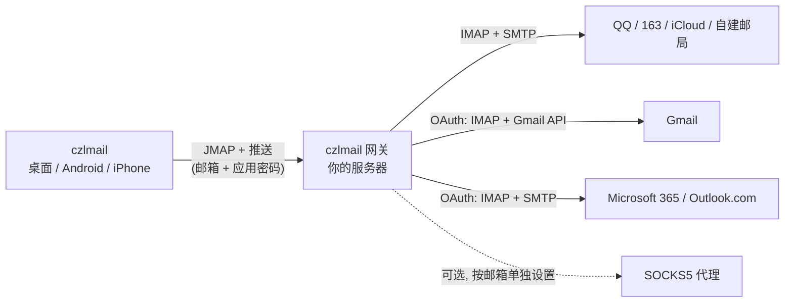
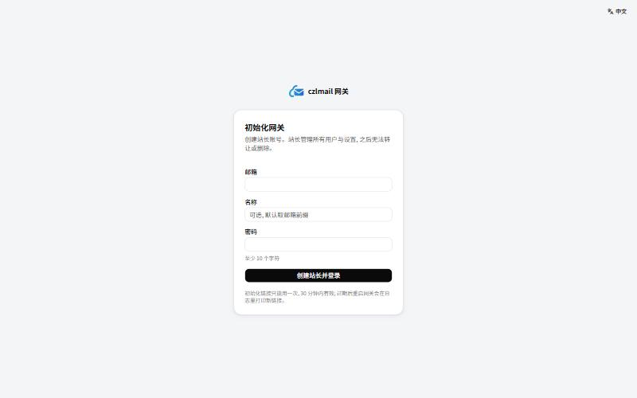
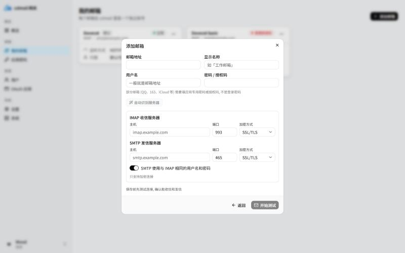
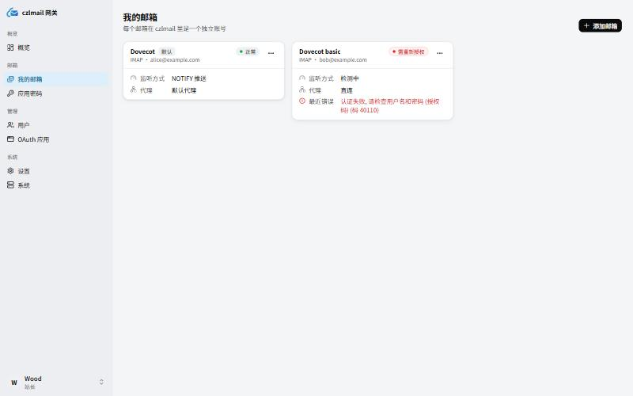
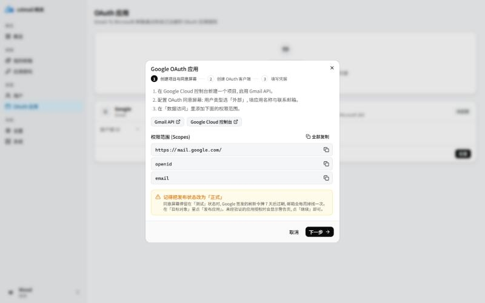
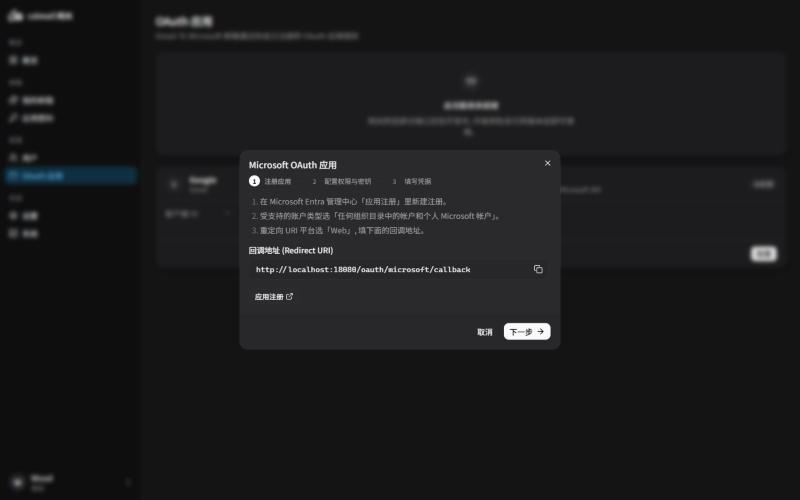
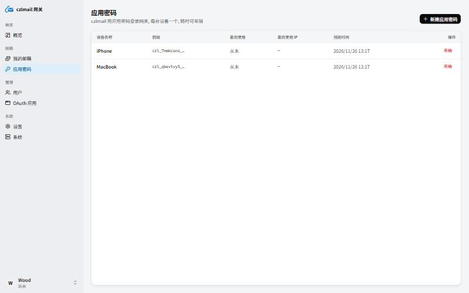
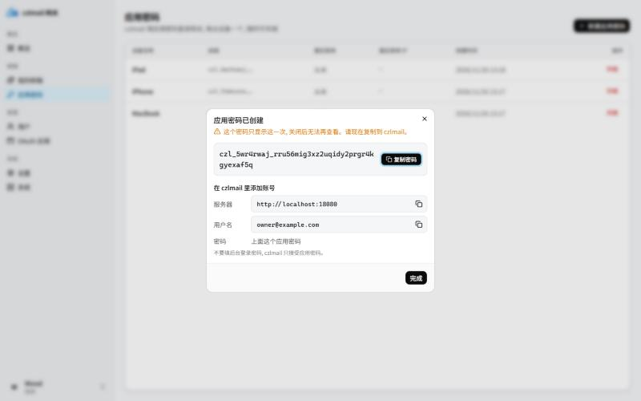
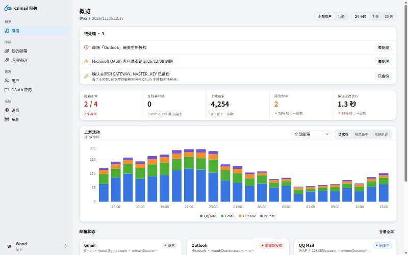
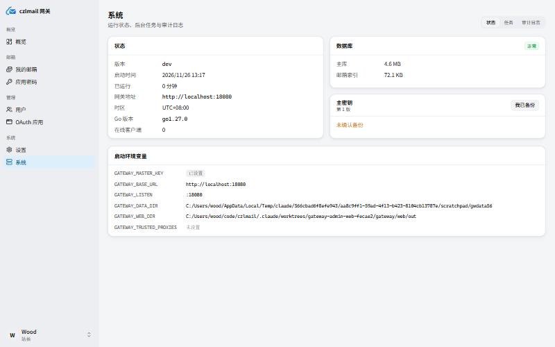

# czlmail 网关部署与使用教程

[English](guide.md) · **简体中文**

## 目录

1. [网关是什么](#1-网关是什么)
2. [部署](#2-部署)
3. [首次初始化](#3-首次初始化)
4. [添加普通 IMAP 邮箱](#4-添加普通-imap-邮箱)
5. [添加 Gmail](#5-添加-gmail)
6. [添加 Microsoft 365 / Outlook.com](#6-添加-microsoft-365--outlookcom)
7. [在 czlmail 里登录](#7-在-czlmail-里登录)
8. [概览面板与邮箱状态](#8-概览面板与邮箱状态)
9. [升级与备份](#9-升级与备份)
10. [常见问题](#10-常见问题)

## 1. 网关是什么

czlmail 只说 JMAP 协议, 原本只能连 Stalwart 这类 JMAP 邮件服务器。czlmail 网关是一个自己部署的转换服务: 它登录你的 Gmail、Microsoft 365 / Outlook.com 和任何支持 IMAP + SMTP 的邮箱 (QQ、163、iCloud、自建邮局等), 再以 JMAP 服务器的身份提供给 czlmail。czlmail 这边不做任何协议适配, 只要登录网关就能收发这些邮箱的邮件。

适合邮箱不在 Stalwart 上、又想用 czlmail 的人, 尤其是手上有好几个邮箱、或者连某些邮箱要走代理 (例如在国内连 Gmail) 的情况。



- 在网关后台添加的每个邮箱, 在 czlmail 里都是一个独立账号; czlmail 只用一组「邮箱 + 应用密码」登录网关。
- 网关用 IMAP NOTIFY / IDLE 盯着上游, 必要时轮询, 有变化就通过 EventSource 推给 czlmail, iPhone 退到后台也能收到新邮件通知。czlmail 自己不轮询。
- 每个邮箱可以直连, 也可以走网关默认的 SOCKS5 代理或单独指定的代理。
- 邮件索引和凭据存在你服务器上的 SQLite 里, 邮箱密码与 OAuth 令牌用主密钥加密。
- 后台在 `/admin`, 中英文双语。

## 2. 部署

### 2.1 准备

- 一台能访问各邮箱服务商的服务器, 装好 Docker
- 一个域名, 下文以 `mail-gw.example.com` 为例, 解析到这台服务器
- 一个 TLS 反向代理 (Caddy、nginx、Traefik 等); 网关本身只监听 HTTP 8080 端口

镜像是 `ghcr.io/woodchen-ink/czlmail-gateway`, 支持 amd64 与 arm64:

| tag | 含义 |
| --- | --- |
| `latest` | 最新正式版 |
| `YYYY.M` | 该月最新的正式版, 如 `2026.11` |
| `YYYY.M.N` | 固定某一版, 如 `2026.11.0` |
| `edge` | `main` 分支最新构建, 未经发版 |

### 2.2 生成并备份主密钥

主密钥 `GATEWAY_MASTER_KEY` 是 32 字节随机数的 base64, 用来加密数据库里的邮箱密码、OAuth 令牌和代理密码:

```sh
openssl rand -base64 32
```

生成后立刻存进密码管理器。主密钥和数据卷缺一不可: 丢了主密钥, 所有已保存的邮箱凭据都解不开, 只能逐个重新添加; 网关发现主密钥与数据不匹配时会拒绝启动。

### 2.3 用 docker compose 部署

新建一个目录, 放两个文件。

`.env`:

```ini
GATEWAY_MASTER_KEY=<上一步生成的主密钥>
GATEWAY_BASE_URL=https://mail-gw.example.com
TZ=Asia/Shanghai
```

`docker-compose.yml`:

```yaml
services:
  gateway:
    image: ghcr.io/woodchen-ink/czlmail-gateway:latest
    restart: unless-stopped
    ports:
      - "127.0.0.1:8080:8080"   # 只给本机的反向代理用
    environment:
      GATEWAY_MASTER_KEY: ${GATEWAY_MASTER_KEY:?}
      GATEWAY_BASE_URL: ${GATEWAY_BASE_URL:?}
      GATEWAY_TRUSTED_PROXIES: ${GATEWAY_TRUSTED_PROXIES:-}
      TZ: ${TZ:-UTC}
    volumes:
      - gateway-data:/data

volumes:
  gateway-data:
```

启动:

```sh
docker compose up -d
docker compose logs -f gateway
```

### 2.4 用 docker run 部署

```sh
docker run -d --name czlmail-gateway --restart unless-stopped \
  -p 127.0.0.1:8080:8080 \
  -e GATEWAY_MASTER_KEY='<主密钥>' \
  -e GATEWAY_BASE_URL=https://mail-gw.example.com \
  -e TZ=Asia/Shanghai \
  -v czlmail-gateway-data:/data \
  ghcr.io/woodchen-ink/czlmail-gateway:latest
```

### 2.5 环境变量

只有启动必需的设置走环境变量, 其余 (注册开关、默认代理、OAuth 应用等) 都在后台里改, 改完即时生效。

| 变量 | 作用 | 默认 |
| --- | --- | --- |
| `GATEWAY_MASTER_KEY` | 主密钥, 见 [2.2](#22-生成并备份主密钥) | 必填 |
| `GATEWAY_BASE_URL` | 网关对外的地址, 如 `https://mail-gw.example.com`。JMAP Session 里的地址和 OAuth 回调地址都由它生成, 必须与浏览器和 czlmail 实际访问的地址完全一致 (协议、域名、端口)。只接受 `https`, 本机测试可用 `http://localhost` | 必填 |
| `GATEWAY_TRUSTED_PROXIES` | 可信反向代理, 格式 `请求头@网段,网段`, 如 `X-Real-IP@172.16.0.0/12`。设置后网关从这个请求头取客户端 IP (用于登录限流与「最近使用 IP」); 留空则用直连对端的地址 | 空 |
| `TZ` | 日志与后台显示的时区 | `UTC` |
| `GATEWAY_LISTEN` | 监听地址 | `:8080` |
| `GATEWAY_DATA_DIR` | 数据目录 | `/data` |

### 2.6 反向代理

网关的 `/jmap/eventsource` 是一条长连接, 反向代理不能缓冲它, 也不能过早断开。czlmail 请求 30 秒一次心跳, 所以读超时只要明显大于 30 秒即可。上传附件单个最大 50 MB, 请求体上限要放宽。

**Caddy** (自动申请证书, 对 EventSource 自动不缓冲):

```caddy
mail-gw.example.com {
    reverse_proxy 127.0.0.1:8080 {
        header_up X-Real-IP {remote_host}
    }
}
```

配合 `GATEWAY_TRUSTED_PROXIES=X-Real-IP@127.0.0.1/32` (Caddy 与网关在同一台机器、网关端口映射到本机时)。Caddy 也跑在 Docker 里时, 网段换成 Docker 网络的网段, 如 `172.16.0.0/12`。

**nginx**:

```nginx
server {
    listen 443 ssl http2;
    server_name mail-gw.example.com;
    # ssl_certificate / ssl_certificate_key ...

    client_max_body_size 60m;

    location / {
        proxy_pass http://127.0.0.1:8080;
        proxy_http_version 1.1;
        proxy_set_header Host $host;
        proxy_set_header X-Real-IP $remote_addr;
        proxy_set_header X-Forwarded-Proto $scheme;
        proxy_buffering off;          # 网关也会发 X-Accel-Buffering: no
        proxy_read_timeout 1h;
    }
}
```

### 2.7 套 Cloudflare 代理时

域名开了 Cloudflare 代理 (橙色云朵) 也能用, 注意这几点:

- 空闲超时 100 秒: Cloudflare 会断开 100 秒没有任何数据的连接。czlmail 的 EventSource 带 `ping=30`, 网关每 30 秒发一次心跳, 不受影响。如果用别的 JMAP 客户端连网关, 它也要请求小于 100 秒的 `ping`, 否则每 100 秒断一次、重连后才收到推送。
- SSL 模式选 Full (strict), 源站用有效证书 (Caddy 自动申请的即可)。
- 真实 IP: 请求经过 Cloudflare 后, 反向代理看到的对端是 Cloudflare 的地址。nginx 里把 `X-Real-IP` 设成 `$http_cf_connecting_ip`, 并且只允许 Cloudflare 的 IP 段访问源站, 否则这个头可以被伪造。
- 上传体积: Cloudflare 免费版单个请求上限 100 MB, 大于网关的 50 MB, 不用调整。

### 2.8 用 dokploy 部署

dokploy 自带 Traefik, 证书和反向代理都由它处理:

1. 在项目里新建 **Compose** 服务, 来源选 **Raw**, 粘贴 [2.3](#23-用-docker-compose-部署) 的 `docker-compose.yml`, 把 `ports` 一段删掉 (由 Traefik 转发, 不必映射端口)。
2. **Environment** 里填 `GATEWAY_MASTER_KEY`、`GATEWAY_BASE_URL=https://mail-gw.example.com`、`TZ`, 以及 `GATEWAY_TRUSTED_PROXIES=X-Real-Ip@10.0.0.0/8,172.16.0.0/12` (Traefik 会带上 `X-Real-Ip`, 网段是 dokploy 的 Docker 网络)。
3. **Domains** 里添加 `mail-gw.example.com`, 服务选 `gateway`, 容器端口 `8080`, 打开 HTTPS, 证书选 Let's Encrypt。
4. **Deploy**, 在 **Logs** 里找初始化链接 (见下一节)。
5. 升级: 改 tag 后重新 Deploy, 或保持 `latest` 直接 Redeploy。命名卷 `gateway-data` 在重新部署时保留; dokploy 的 **Volume Backups** 可以定时备份它。

## 3. 首次初始化

网关没有用户时, 启动日志里会打印一次性的初始化链接:

```sh
docker compose logs gateway | grep setup_url
```

```json
{"level":"WARN","msg":"no user yet: open the setup link ...","setup_url":"https://mail-gw.example.com/admin/setup/?token=…"}
```

打开链接, 填站长的邮箱、名称和密码 (至少 10 个字符), 创建后直接进入后台。这里的邮箱只是登录网关用的账号名, 不需要是真实邮箱, 但 czlmail 登录时要填同一个。



- 链接只能用一次, 30 分钟内有效; 过期了重启网关会打印新的。
- 第一个用户是**站长**, 之后不能转让或删除。站长和**管理员**可以在「用户」里创建其他用户; 普通**用户**只管理自己的邮箱和应用密码。
- 自助注册默认关闭 (「设置 · 注册」), 自用网关保持关闭即可。
- 后台语言默认跟随浏览器, 在登录页右上角、用户菜单或「设置 · 外观」可以切换中文 / English 和明暗主题。

## 4. 添加普通 IMAP 邮箱

适用于所有支持 IMAP + SMTP 的邮箱: QQ、163、126、iCloud、Yahoo、Fastmail、自建邮局等。

1. 在邮箱服务商那里开启 IMAP / SMTP, 并生成**授权码或应用专用密码**。QQ、163、iCloud 等不接受登录密码, 必须用授权码。
2. 后台「我的邮箱」→「添加邮箱」→ IMAP, 填邮箱地址、显示名称、用户名 (一般就是邮箱地址) 和授权码。
3. 填 IMAP 与 SMTP 服务器的主机、端口和加密方式。只支持加密连接: `SSL/TLS` (IMAP 993 / SMTP 465) 或 `STARTTLS` (IMAP 143 / SMTP 587)。SMTP 默认使用与 IMAP 相同的用户名和密码。
4. 点「开始测试」。网关会实际登录 IMAP、对 SMTP 做 EHLO 与认证 (不发信), 分别显示结果; 两边都通过才能保存。



保存后进入「同步中」: 网关从新到旧导入每个文件夹的邮件元数据, 每批 500 封, 正文在 czlmail 打开时才下载。导入完成前 czlmail 里这个账号会提示「网关正在首次导入」, 完成后邮件自动出现。用户的第一个邮箱自动成为默认邮箱 (czlmail 的主账号), 卡片菜单里的「设为默认」可以改。



每张卡片显示状态、监听方式和代理。监听方式说明新邮件多快能到:

| 监听方式 | 含义 |
| --- | --- |
| NOTIFY 推送 | 服务器支持 IMAP NOTIFY, 所有文件夹约 1 秒内推送 |
| IDLE 推送 | 收件箱约 1 秒内推送, 其它文件夹轮询 (有变化后每分钟, 平时每 3 分钟, 垃圾邮件与已删除每 10 分钟) |
| 轮询 | 服务器不支持推送, 全部靠轮询 |

卡片右上角的菜单里有「测试连接」「暂停同步 / 恢复同步」「更新密码」「代理设置」「设为默认」「删除邮箱」。删除只断开网关并删除本地索引, 邮箱服务器上的邮件不受影响。

### SOCKS5 代理

每个邮箱的所有连接 (IMAP、SMTP, Gmail / Microsoft 还包括 OAuth 与它们的 API) 都可以走 SOCKS5 代理, 域名由代理解析。

- **网关默认代理**: 管理员在「设置 · 网络与安全」填「默认 SOCKS5 代理」(`socks5://用户名@主机:端口`) 和「默认代理密码」, 留空为直连。
- **单个邮箱**: 卡片菜单「代理设置」, 三选一: 使用网关默认代理 (默认)、直连不走代理、自定义 SOCKS5 代理。

代理故障只影响用它的邮箱: 这些邮箱显示「无法连接」并退避重试 (5 秒到 5 分钟), 其它邮箱照常同步。

网关默认拒绝连接内网、回环地址 (防止被用来探测所在网络)。邮局或代理和网关在同一内网 (例如代理是同一 compose 里的 sidecar 容器) 时, 在「设置 · 网络与安全」打开「允许连接内网地址」。

## 5. 添加 Gmail

> 本节依据 Gmail 支持的开发分支 ([#59](https://github.com/woodchen-ink/czlmail/pull/59)) 编写, 合并后可能有措辞调整。

Gmail 用 OAuth 授权: 收信走 IMAP, 发信走 Gmail API, 不保存 Gmail 密码。Google 要求每个网关用自己的 OAuth 应用, 由管理员在 Google Cloud 里建一次; 之后用户只需点「添加邮箱 → Gmail」并登录 Google。

### 5.1 在 Google Cloud 创建 OAuth 客户端 (管理员, 只做一次)

1. 打开 [Google Cloud 控制台](https://console.cloud.google.com/), 顶栏项目选择器 →「新建项目」, 名称随意, 如 `Mail gateway`。
2. 「API 和服务 → 库」, 搜索 **Gmail API**, 点「启用」。不启用的话发信会报 403。
3. 「API 和服务 → OAuth 同意屏幕」(新版控制台叫「Google Auth Platform」, 分为「品牌塑造」「目标对象」「数据访问」):
   - 用户类型选**外部**。如果所有 Gmail 都在你自己的 Google Workspace 里, 可以选**内部**, 那样第 7 步和下面的未验证警告都不涉及。
   - 应用名称、用户支持邮箱、开发者联系邮箱随意填写; 用户登录 Google 时会看到应用名称。
   - 「数据访问」里添加权限范围 `https://mail.google.com/` (显示为「阅读、撰写、发送和永久删除您在 Gmail 中的所有电子邮件」)。这是受限范围; 网关后台的向导会列出需要的全部范围, 可直接复制。
4. 「API 和服务 → 凭据 → 创建凭据 → OAuth 客户端 ID」, 应用类型选 **Web 应用**。
5. 「已获授权的重定向 URI」添加 `https://mail-gw.example.com/oauth/google/callback`, 也就是 `GATEWAY_BASE_URL` 加 `/oauth/google/callback`, 必须一字不差。后台「OAuth 应用」页会显示正确的值。点「创建」, 复制**客户端 ID** 和**客户端密钥**。
6. 网关后台「OAuth 应用」→ Google, 按向导把客户端 ID 和密钥填进去。密钥加密保存, 之后不再显示。
7. 回到「OAuth 同意屏幕 / 目标对象」, 把**发布状态**改为**正式版** (「发布应用」)。停留在「测试」状态时, Google 签发的刷新令牌 7 天后失效, 所有 Gmail 邮箱每周都要重新授权一次, 而且只有列入测试用户的账号能登录。



**未验证应用警告**: 发布为正式、使用受限范围、但没经过 Google 验证的外部应用, 登录时会显示「Google 尚未验证此应用」。自部署网关属于这种情况, 点「高级 → 转至 <应用名称> (不安全)」继续即可。未验证应用终身最多 100 个用户; 只有超过这个数才值得申请验证 (受限范围需要安全评估)。

### 5.2 添加 Gmail 邮箱 (每个用户)

1. 「我的邮箱」→「添加邮箱」→ Gmail, 可以预先填邮箱地址 (Google 登录页会预选) 和代理。
2. 跳转到 Google, 登录并同意授权。**不要取消勾选 Gmail 权限**, 否则邮箱不会被添加。
3. 授权完成后回到「我的邮箱」, 新邮箱进入首次同步。

- 授权链接 10 分钟内有效, 只能用一次, 并且要在登录后台的同一个浏览器里完成。
- 再次添加同一个地址只会更新令牌, czlmail 里的账号和数据不变。
- 邮箱变成「需重新授权」(改了 Google 密码、在 Google 账号里移除了访问权限、更换了客户端密钥) 时, 点卡片菜单的「重新授权」, 用同一个地址登录即可, 账号不变。
- 在网关里删除 Gmail 邮箱时, 网关会同时撤销它在 Google 那边的授权。

### 5.3 Gmail 在 czlmail 里的样子

- 标签就是文件夹, 一封邮件可以同时在多个文件夹里; 收件箱、已发送、草稿对应 Gmail 的系统标签, 自建标签保留层级; 没有任何标签的邮件在「归档」。
- 星标对应 czlmail 的旗标; 「重要」和收件箱分类不显示。
- 移动邮件就是改标签, 归档只去掉收件箱标签; 删除进 Gmail 的垃圾箱, 从垃圾箱恢复会带回原来的标签。
- 搜索走 Gmail 自己的搜索。
- 发信身份是 Gmail「设置 → 账号 → 用这个地址发送邮件」里的地址, 每 6 小时同步一次, 要增删请到 Gmail 里改。

## 6. 添加 Microsoft 365 / Outlook.com

> 本节依据 Microsoft 支持的开发分支 ([#57](https://github.com/woodchen-ink/czlmail/pull/57)) 编写, 合并后可能有措辞调整。

工作 / 学校账号 (Microsoft 365、Exchange Online) 和个人账号 (Outlook.com、Hotmail、Live) 都通过 OAuth 2.0 登录 IMAP `outlook.office365.com:993` 与 SMTP `smtp.office365.com:587`, 不保存密码。网关需要在 Microsoft Entra 里注册一个应用, 由管理员做一次。

### 6.1 在 Microsoft Entra 注册应用 (管理员, 只做一次)

注册应用需要一个 Microsoft Entra 目录: 任何 Microsoft 365 或 Azure 账号都自带一个, 没有的话注册一个免费 Azure 账号即可。

1. 打开 [Microsoft Entra 管理中心](https://entra.microsoft.com) →「标识」→「应用程序」→「应用注册」→「新注册」。
2. **名称**: 用户在授权页上看到的名字, 如 `czlmail gateway`。
3. **受支持的帐户类型**: 选「任何组织目录 (任何 Microsoft Entra ID 租户 - 多租户) 中的帐户和个人 Microsoft 帐户」。只给自己组织用时可以选更窄的类型, 但要同时在网关里填「租户」(见 6.2)。
4. **重定向 URI**: 平台选 **Web**, 填 `https://mail-gw.example.com/oauth/microsoft/callback`, 必须与 `GATEWAY_BASE_URL` 完全一致 (包括协议和端口)。点「注册」。
5. 在应用的「概述」页复制**应用程序 (客户端) ID**。
6. 「证书和密码」→「客户端密码」→「新建客户端密码」, 选一个有效期 (最长 24 个月), 立刻复制密码的**值** (只显示这一次; 「机密 ID」不是密码), 并记下到期日。
7. 「API 权限」→「添加权限」→「Microsoft Graph」→「委托的权限」, 勾选 `openid`、`email`、`offline_access` (在「OpenId 权限」下)、`IMAP.AccessAsUser.All` 和 `SMTP.Send`。`User.Read` 可留可删, 其它不需要。如果只有你自己的组织使用网关, 在这里点「代表 <组织> 授予管理员同意」, 组织里的用户就不会再看到授权确认页。

注册里其它设置都不用动: 不开隐式授权, 不加移动端 / SPA 平台, 不传证书。



### 6.2 把应用填进网关

后台「OAuth 应用」→ Microsoft, 按向导填:

- **客户端 ID** 与**客户端密钥** (上面第 5、6 步)。
- **密钥到期日**: 网关在到期前 30 天在概览里提醒。到期后所有 Microsoft 邮箱都会变成「需重新授权」。换密钥时在 Entra 新建一个密码, 连同新到期日填进来, 因旧密钥停下的邮箱会自动恢复; 密钥留空表示保留已保存的。
- **租户** (可选): 留空或 `common` 表示个人和工作账号都可以; `organizations` 只允许工作 / 学校账号; `consumers` 只允许个人账号; 单租户应用填租户 ID 或域名 (如 `contoso.onmicrosoft.com`)。

### 6.3 添加 Microsoft 邮箱 (每个用户)

「我的邮箱」→「添加邮箱」→ Microsoft, 登录微软账号并同意授权, 完成后回到「我的邮箱」。邮箱地址取自登录的账号。再次添加同一地址只更新令牌, 账号不变。

授权失效时 (改了密码、移除了应用、管理员吊销了会话、MFA 或条件访问要求重新登录), 只有这个邮箱变成「需重新授权」, 用卡片菜单的「重新授权」处理。Microsoft 返回的 `AADSTS…` 错误码会显示在状态详情里。

### 6.4 组织不允许用户自行授权

很多组织只允许管理员批准应用, 用户登录时会看到「需要管理员批准」(AADSTS90094 / AADSTS65001)。处理办法任选其一:

- 把网关的**管理员同意链接**发给该组织的管理员 (接口 `GET /api/admin/oauth-apps` 里 Microsoft 应用的 `adminConsentUrl`), 由对方用管理员账号登录并代表整个组织同意。之后组织里的用户照常添加邮箱。
- 该组织管理员在自己的 Entra 里: 「企业应用程序」→ 这个应用 →「权限」→「授予管理员同意」。

### 6.5 Exchange 关掉了 IMAP 或 SMTP 认证

Microsoft 365 可以按邮箱关闭 IMAP 和 SMTP 认证, 新租户默认关闭 SMTP 认证。

| 测试连接报错 | 原因 | 处理 |
| --- | --- | --- |
| 40313 `imap_access_disabled` | 这个邮箱的 IMAP 被关了, 或登录的账号不是邮箱的所有者 | Microsoft 365 管理中心 →「用户」→「活跃用户」→ 该用户 →「邮件」→「管理电子邮件应用」, 勾选 **IMAP**; 或 `Set-CASMailbox -Identity me@contoso.com -ImapEnabled $true` |
| 40312 `smtp_auth_disabled` | SMTP 认证被关了, 收信不受影响 | 同一处勾选**经过身份验证的 SMTP**; 或 `Set-CASMailbox -Identity me@contoso.com -SmtpClientAuthenticationDisabled $false` (单个邮箱) / `Set-TransportConfig -SmtpClientAuthenticationDisabled $false` (整个租户) |

### 6.6 Microsoft 邮箱的差异

- Exchange 不支持 NOTIFY 和 CONDSTORE / QRESYNC: 收件箱用 IDLE 推送, 其它文件夹轮询。
- 文件夹角色按 Exchange 的特殊用途标记识别, 没有标记时按名称 (含邮箱语言的本地化名称)。
- Exchange 会自己把发出的邮件存进「已发送邮件」, 网关不再另存一份。
- Microsoft 没有撤销单个令牌的接口: 在网关里删除邮箱会删掉令牌, 用户还可以在 <https://account.live.com/consent/Manage> (个人账号) 或 <https://myapps.microsoft.com> (工作账号) 移除应用的访问权限。

## 7. 在 czlmail 里登录

czlmail 用「网关登录邮箱 + 应用密码」登录, 不用后台密码, 也不用 Gmail 等邮箱自己的密码。每台设备建一个应用密码, 丢了设备只吊销那一个。

1. 后台「应用密码」→「新建应用密码」, 名称写设备名, 如 `MacBook`、`iPhone`。

   

2. 弹窗显示密码 (形如 `czl_ab12cd34_…`) 和 czlmail 里要填的内容。**密码只显示这一次**, 立刻复制。

   

3. 在 czlmail 的登录页填:
   - **服务器**: 网关地址, 如 `mail-gw.example.com` (即 `GATEWAY_BASE_URL`)
   - **邮箱**: 登录网关后台用的邮箱
   - **应用专用密码**: 上一步复制的密码

czlmail 识别出网关后, 网关里的每个邮箱都显示为一个独立账号, 默认邮箱是主账号。之后在网关后台添加或删除邮箱, czlmail 刷新 Session 后会出现或移除对应账号, 不用重新登录。

- 某个邮箱出问题 (需重新授权、连不上、暂停) 时, czlmail 只在这个账号上提示, 其它邮箱照常收发; 提示里的「打开网关后台」直接跳到后台。
- 应用密码列表显示每个密码最近的使用时间和 IP。吊销后对应设备在下一次请求时即被拒绝, 推送连接立即断开。
- 网关里还没有邮箱时, czlmail 会提示「网关里还没有邮箱, 请先到网关后台添加」。

## 8. 概览面板与邮箱状态

「概览」用来看网关是否正常、有没有要处理的事。管理员可以在「全部用户」和「我的」之间切换, 普通用户只看到自己的邮箱。



- 「待处理」列出需要重新授权的邮箱、30 天内到期的 Microsoft 客户端密钥、还没确认备份的主密钥。点「去处理」直接跳到对应页面。
- 指标卡依次是正常邮箱数 / 总数、在线客户端 (当前的 EventSource 连接数)、上游请求数、限流命中次数、推送延迟 p95 (从上游通知到推给 czlmail 的耗时), 均与上一周期对比。
- 「上游活动」是 24 小时 / 7 天 / 30 天的按小时趋势, 可切换请求数、限流命中和推送延迟, 也可以只看某个邮箱。
- 「邮箱状态」里每个邮箱一张卡片, 显示状态、监听方式、最近同步时间、首次同步进度、最近错误和代理。

### 状态与处理

| 状态 | 码 | 含义 | 处理 |
| --- | --- | --- | --- |
| 正常 | | 已同步, 正在监听 | 无 |
| 同步中 | 50310 | 首次导入进行中, 卡片显示进度 | 等待完成。导入期间 czlmail 里这个账号暂时不能读写 |
| 需重新授权 | 40110 | 服务器拒绝了密码, 或 OAuth 授权失效 | IMAP 邮箱用「更新密码」填新的授权码; Gmail / Microsoft 用「重新授权」。网关不会自动重试, 改好之前一直保持这个状态 |
| 无法连接 | 50210 | 网络、代理、TLS 或服务器故障 | 网关自动退避重试 (5 秒到 5 分钟)。看「最近错误」定位原因 |
| 无法连接 (限流) | 42910 | 邮箱服务商在限制网关的访问频率 | 无需处理, 稍后自动恢复。频繁出现时检查是否有其它程序在同时大量访问这个邮箱 |
| 已暂停 | 42310 | 你在卡片菜单里暂停了同步 | 「恢复同步」 |

「需重新授权」和「无法连接」期间, 已经同步到网关的内容 (文件夹、邮件列表、已缓存的正文) 在 czlmail 里仍然能看; 需要连服务器的操作 (下载未缓存的正文、服务器端搜索、移动、删除、发信) 会失败并提示原因。

### 测试连接的错误码

| 码 | 含义 | 处理 |
| --- | --- | --- |
| 40110 | 认证失败 | 检查用户名与授权码; QQ、163、iCloud 要用授权码而不是登录密码 |
| 40311 | 服务器解析到内网地址 | 在「设置 · 网络与安全」打开「允许连接内网地址」 |
| 40312 / 40313 | Microsoft 关闭了 SMTP 认证 / IMAP | 见 [6.5](#65-exchange-关掉了-imap-或-smtp-认证) |
| 42910 | 服务商限流 | 稍后再试 |
| 50210 | 连不上服务器 (超时、连接被关闭) | 检查主机和端口; 服务器在墙外时给这个邮箱配代理 |
| 50211 | 代理连接失败 | 检查代理地址、用户名和密码, 以及代理是否在线 |
| 50212 | TLS 握手失败 | 加密方式和端口不匹配: 993 / 465 用 SSL/TLS, 143 / 587 用 STARTTLS |
| 50213 | 服务器拒绝了请求 | 看测试结果里服务器返回的原文 |

### 系统页

「系统」显示版本、数据库大小、主密钥状态和启动环境变量 (密钥只显示「已设置」)。确认主密钥已经备份后点「我已备份」, 概览里的待处理就会消失。「任务」页列出后台任务的最近执行记录, 可以手动执行; 「审计日志」记录后台里的每一次修改, 保留 180 天。



## 9. 升级与备份

### 升级

```sh
docker compose pull
docker compose up -d
```

数据库结构在启动时自动迁移。想控制升级节奏就把 tag 固定为 `YYYY.M.N`, 需要时再改; 用 `YYYY.M` 则只跟随当月的修正版。不建议生产环境用 `edge`。

### 备份

要备份的只有两样, 必须一起保存:

- **主密钥** `GATEWAY_MASTER_KEY`: 存在密码管理器里, 只需备份一次。
- **数据卷** (`/data`): `gateway.sqlite` (用户、应用密码、邮箱配置与加密的凭据、发信身份) 与 `upstreams/` (每个邮箱的索引)。`cache/` 是正文缓存, 可以不备份。

邮箱索引丢了可以从邮箱服务器重新导入, `gateway.sqlite` 和主密钥丢了就只能从头配置。备份时先停容器, 保证 SQLite 文件一致:

```sh
docker compose stop gateway
docker run --rm -v <目录名>_gateway-data:/data -v "$PWD":/backup alpine \
  tar czf /backup/gateway-data-$(date +%F).tgz -C /data --exclude=./cache .
docker compose start gateway
```

恢复: 新建同名卷, 把归档解压进去, 用**同一个主密钥**启动。

### 更换主密钥

主密钥泄露或需要轮换时, 停掉网关, 用 `rotate-key` 把所有密文从旧密钥重新加密到新密钥:

```sh
docker compose stop gateway
docker compose run --rm \
  -e GATEWAY_OLD_MASTER_KEY='<旧主密钥>' \
  -e GATEWAY_MASTER_KEY='<新主密钥>' \
  gateway rotate-key
```

成功后把 `.env` 里的 `GATEWAY_MASTER_KEY` 改成新密钥, 再 `docker compose up -d`, 并把新密钥备份好、在「系统」页重新确认备份。

### 更换域名

改 `GATEWAY_BASE_URL` 之后:

- Google Cloud 与 Microsoft Entra 里的重定向 URI 要同步改成新地址
- czlmail 里的服务器地址要改, 或用新地址重新登录

## 10. 常见问题

**czlmail 提示「这个地址上没有找到 JMAP 服务」**
服务器地址填错了, 或反向代理没有把请求转到网关。浏览器打开 `https://mail-gw.example.com/.well-known/czlmail.json`, 能看到包含 `gateway` 的 JSON 才说明网关可达。

**用户名密码都对, czlmail 却登录失败**
czlmail 要填的是应用密码 (`czl_…`), 不是后台登录密码, 也不是 Gmail / QQ 的密码。登录失败太多次会被限流 (HTTP 429), 等一会儿再试。

**新邮件到得慢**
看邮箱卡片的监听方式: 「轮询」说明服务器不支持推送, 收件箱以外的文件夹在 IDLE 模式下也是轮询。如果在用 Cloudflare 或其它代理, 确认它没有缓冲 EventSource (见 [2.6](#26-反向代理)、[2.7](#27-套-cloudflare-代理时))。

**Gmail 每过 7 天就要重新授权**
OAuth 同意屏幕还是「测试」状态, 改为「正式版」后重新授权一次即可, 见 [5.1](#51-在-google-cloud-创建-oauth-客户端-管理员-只做一次) 第 7 步。

**授权回调报 `redirect_uri_mismatch`**
Google / Entra 里填的重定向 URI 与 `GATEWAY_BASE_URL` 不一致。注意协议 (`https`)、域名、端口和末尾路径都要一致, 可以从后台「OAuth 应用」页直接复制。

**所有 Microsoft 邮箱同时变成「需重新授权」**
多半是客户端密钥到期了。在 Entra 新建密钥, 在「OAuth 应用」里填新密钥和到期日, 邮箱会自动恢复。

**连自建邮局报 40311**
邮局和网关在同一内网, 地址解析到了内网 IP。在「设置 · 网络与安全」打开「允许连接内网地址」。

**丢了主密钥**
已保存的邮箱密码、OAuth 令牌和代理密码都无法解开。用新主密钥和空数据卷重新部署, 再逐个添加邮箱。用户和应用密码也需要重建。

**网关会把我的邮件存一份吗**
网关只存邮件的元数据索引 (主题、发件人、日期、标记等) 和按需下载的正文缓存 (最多 500 MB, 按最近使用淘汰)。邮件本身始终在原邮箱服务器上, 删除网关里的邮箱不影响服务器上的邮件。

**多人共用一个网关**
站长或管理员在「用户」里给每个人建账号; 每个人用自己的账号登录后台, 添加自己的邮箱、建自己的应用密码。OAuth 应用只需管理员配置一次, 所有用户共用。
